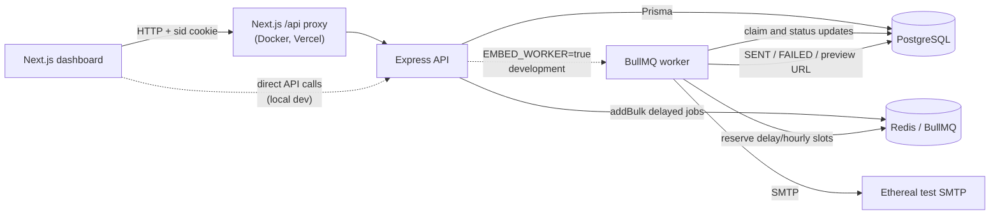
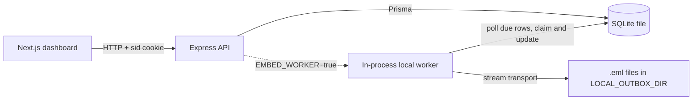
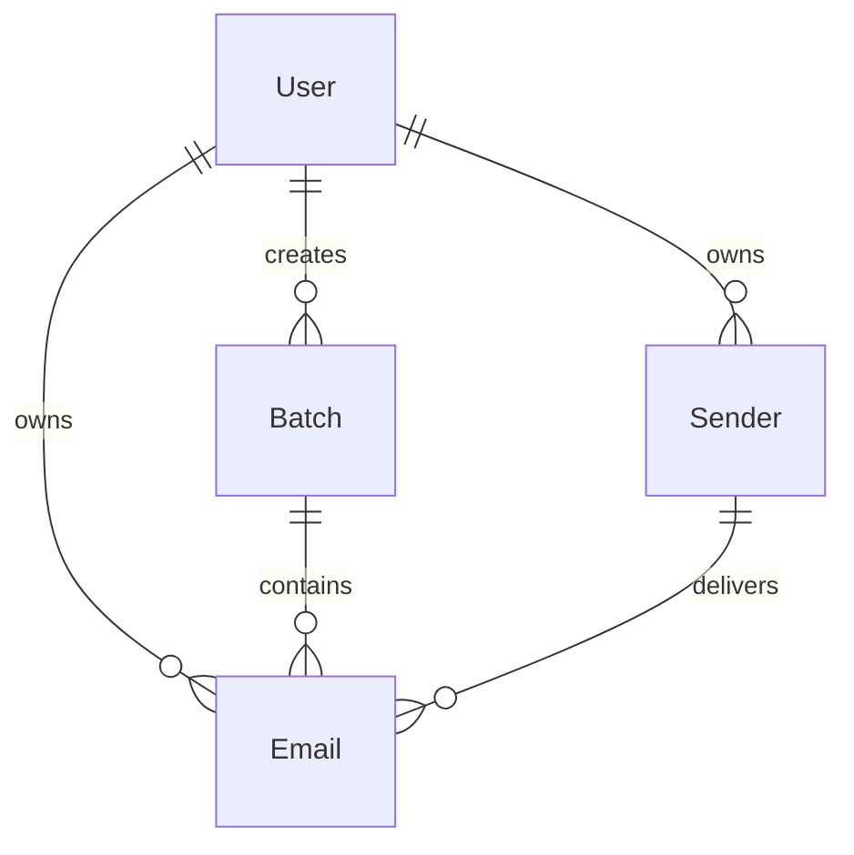

# ReachInbox Email Scheduler: Project Documentation

This document describes the current implementation in this repository. It is
based on the source code, Prisma schema, migrations, package scripts, Docker
configuration, and the notes in `agentref/`. Where a claim could not be verified
from those sources, it is marked as unverified.

## A. Project Overview

### Purpose

ReachInbox is a full-stack email job scheduler. It accepts a batch of
recipients, stores one durable database row per recipient, and delivers the
messages through multiple senders while enforcing a minimum gap between sends
and an hourly cap. Delivery runs in one of two interchangeable modes:

- The default local mode uses a SQLite file, an in-process database-polling
  worker, synthetic senders, and an `.eml` outbox. It needs only Node.js; no
  PostgreSQL, Redis, Docker, SMTP account, or internet connection is required.
- The hosted mode uses PostgreSQL, BullMQ delayed jobs backed by Redis, and
  Ethereal SMTP. It is the deployment path for Render and Docker Compose.

Both modes share the same API, planner, dashboard, tests, and pacing rules. The
active mode is selected with `QUEUE_DRIVER` and `MAIL_TRANSPORT`.

The project solves three problems that a simple send loop does not:

- Scheduling survives API and worker restarts because the database, PostgreSQL
  or SQLite, is the source of truth; hosted BullMQ jobs are rebuilt from it.
- Large batches are paced per sender, so one batch cannot consume the entire
  allowance at once.
- Delivery state, retries, cancellation, and preview or outbox output are
  visible in a dashboard.

### Main features

- Google OAuth login with a signed, HTTP-only session cookie.
- Local-only demo login for development, Docker, and the SQLite mode without
  Google credentials.
- A zero-dependency local mode: SQLite, an in-process worker, synthetic senders,
  and `.eml` files written to `backend/.mail-outbox`.
- Runtime driver selection: `QUEUE_DRIVER=local|bullmq` and
  `MAIL_TRANSPORT=local|ethereal`, defaulting to local outside production and to
  the hosted stack in production.
- Compose view with recipients, CSV or text lead upload, subject, body, start
  time, delay between emails, and a per-sender hourly limit.
- Scheduled and Sent tabs with counts, search, five-second polling, detail
  views, and Ethereal preview links when available.
- Per-sender planning and hourly enforcement, in process locally and through
  Redis across workers in hosted mode.
- Deferred over-limit jobs that move to a later window instead of failing.
- Idempotent batch submission, idempotent job IDs, and deterministic
  `Message-ID` values.
- Atomic database claims, transient retries with backoff, and permanent-failure
  handling in both worker implementations.
- Restart reconciliation that rebuilds missing queued jobs from the database.
- Single-email cancellation and bulk deletion of all queued scheduled emails.
- One-command local bootstrap and a zero-configuration local Docker stack.
- A 1,000-recipient planning and bulk-enqueue test, a local end-to-end smoke
  check, and a separate hosted Redis benchmark command.

### Implementation status

The core scheduling, persistence, worker, rate-limit, cancellation, and
dashboard paths are implemented and covered by backend tests. The backend test
suite (32 tests in 7 files), backend typecheck/build, and frontend
typecheck/lint/build pass. The SQLite local mode was verified in a fresh copy
without environment files or installed dependencies: `npm run setup` generated
both Prisma clients and the database, `npm run test:local` passed, and a browser
session completed demo login, immediate scheduling, an `.eml` outbox delivery,
and single cancellation. The Docker Compose stack and per-user Ethereal
provisioning were exercised earlier in the recorded work.

The live Google browser consent flow was not completed during the recorded
work. The Google OAuth code path exists and was tested up to the point of
redirect and token exchange, but a successful interactive sign-in was not
verified. Live Ethereal delivery was verified manually in earlier recorded work,
not by the automated test suite. No production deployment was performed.

### Intended users and use cases

The repository is structured as an assignment and demo project for scheduling
cold-email batches. Its intended use is local evaluation, a small internal
dashboard, or a prototype. It is not configured as a multi-tenant production
mail platform. Each user owns a separate sender pool, but there is no team or
tenant model and no administrator role. Local senders are synthetic rows with
empty passwords; hosted Ethereal sender credentials are stored in plaintext.

## B. Technology Stack

### Frontend

- Next.js 16.4.3 using the App Router and Turbopack.
- React 19.3.0 and TypeScript 5.
- Tailwind CSS 4 through `@tailwindcss/turbopack`.
- `lucide-react` icons.
- Native `fetch` through a typed API client; no separate state-management or
  data-fetching library.
- `next/font` with Geist and Geist Mono.

### Backend

- Node.js 20 or newer. The Docker images use Node 22.
- Express 4 with TypeScript, compiled to ES modules with `tsc`.
- Zod for environment and request validation.
- Helmet, CORS, cookie-parser, and Pino.
- `jsonwebtoken` for session cookies and `google-auth-library` for Google token
  verification.

### Data and queue

- Local mode: a SQLite file selected by `DATABASE_URL=file:...`, Prisma with a
  generated SQLite client, and an in-process database-polling worker coordinated
  by `LocalPacer`. No Redis or PostgreSQL process is involved.
- Hosted mode: PostgreSQL 16, the standard Prisma client, Redis 7 with AOF
  (`appendfsync everysec`) and `maxmemory-policy noeviction`, and BullMQ 5
  delayed jobs.
- The database driver is chosen automatically from the `DATABASE_URL` scheme:
  `file:` selects the generated SQLite client, anything else selects the
  PostgreSQL client.

### Email delivery

- Local mode: Nodemailer stream transport writes one `.eml` file per message to
  `LOCAL_OUTBOX_DIR` (default `backend/.mail-outbox`). Synthetic senders use
  addresses of the form `sender-<n>-<userId>@outbox.local` and require no
  network access or credentials.
- Hosted mode: Nodemailer with Ethereal test SMTP accounts. Sender credentials
  are generated per user on first sign-in by the provisioning service and stored
  in the `Sender` table; they are not environment variables. The repair script
  can provision missing senders for existing users.

### Authentication

- Google OAuth 2.0 through `google-auth-library`.
- A signed JWT stored in an HTTP-only cookie named `sid`.
- A local demo endpoint enabled only outside production.
- No Firebase SDK, Firebase Authentication, NextAuth, Passport, or
  email/password authentication is used.

### Infrastructure and tooling

- The default local mode needs only Node.js 20+ and one command.
- Docker and Docker Compose are optional; Compose runs the production-shaped
  stack with PostgreSQL, Redis, BullMQ, and Ethereal.
- Vercel configuration for the dashboard and a Render Blueprint for the API,
  BullMQ worker, PostgreSQL, and Key Value store.
- Vitest for backend unit tests and a zero-dependency local smoke script.
- ESLint (`eslint-config-next`) for the frontend.
- TypeScript project builds for both applications.

Local scheduling uses a database-polling worker rather than a job framework;
there is no cron, `node-cron`, `agenda`, or scheduling `setInterval`. Hosted
scheduling uses BullMQ delayed jobs only. Both paths claim rows in the database
and enforce the same delay and hourly rules.

## C. Project Architecture

### Repository structure

```text
.
|- backend/
|  |- prisma/
|  |  |- schema.prisma             PostgreSQL data model and migrations
|  |  |- schema.sqlite.prisma      SQLite mirror for the local mode
|  |  |- migrations/               Applied PostgreSQL SQL migrations
|  |- generated/sqlite-client/     Generated SQLite Prisma client
|  |- scripts/
|  |  |- prisma-generate.mjs       Generates both Prisma clients
|  |  |- seed-senders.ts           Repairs per-user sender pools in either mode
|  |  |- load-test.ts              Hosted Redis planning/enqueue benchmark
|  |- src/
|  |  |- config/env.ts             Zod-validated environment and driver defaults
|  |  |- lib/                      Prisma selection, Redis, windows, errors, logging
|  |  |- middleware/               Session authentication and error handling
|  |  |- queue/                    Queue facade, BullMQ and local workers, reconciler
|  |  |- ratelimit/hourly.ts       Redis Lua reservation script
|  |  |- routes/                   Auth, schedule, emails, health, admin
|  |  |- services/                 Planner, senders, SMTP and outbox delivery
|  |  |- app.ts                    Express application
|  |  |- server.ts                 API process and optional embedded worker
|  |  |- worker.ts                 Standalone BullMQ worker process
|  |- test/                        Vitest suites
|- frontend/
|  |- public/                      Static assets
|  |- src/
|  |  |- app/                      App Router page, layout, global styles
|  |  |- components/               Auth, layout, list, detail, compose, uploader
|  |  |- context/                  Toast provider
|  |  |- hooks/                    Session and email data hooks
|  |  |- lib/                      API client and lead parser
|  |  |- services/                 Auth and email API wrappers
|  |  |- types/api.ts              Frontend API contract
|- scripts/dev.mjs                 One-command local bootstrap and process runner
|- scripts/smoke-local.mjs         Zero-dependency local end-to-end smoke check
|- docker-compose.yml              Production-shaped PostgreSQL/Redis/BullMQ stack
|- render.yaml                     Render API, worker, PostgreSQL, and Key Value Blueprint
|- frontend/vercel.json            Vercel project configuration for the dashboard
|- DEPLOYMENT.md                   Vercel + Render production runbook
|- HOW_TO_RUN.md                   Local runbook and demo checklist
|- README.md                       Project entry point
```

### Frontend structure

`frontend/src/app/page.tsx` is a client-rendered dashboard shell. It owns the
selected tab, the current view (`list`, `detail`, or `compose`), search text,
selected email ID, and compose recipients. It uses:

- `useAuth` to load the current session and handle Google, demo, and logout
  actions.
- `useEmails` to fetch scheduled emails, sent emails, and status counts, and to
  poll every five seconds while authenticated.
- `EmailListView` for both tabs, including search filtering, cancellation, and
  bulk deletion.
- `EmailDetailView` for scheduled and delivered message details.
- `ComposeEmailView` for scheduling and validation.
- `CsvUploaderModal` for parsing CSV and text lead files.

All API requests go through `frontend/src/lib/api-client.ts`. The client uses
`credentials: 'include'`, sends JSON, maps error responses to `ApiError`, and
reads the base URL from `NEXT_PUBLIC_API_BASE_URL` (with a legacy
`NEXT_PUBLIC_API_URL` fallback and a localhost default).

The frontend does not connect to PostgreSQL, Redis, or SMTP. It only calls the
Express API.

### Backend structure

`backend/src/app.ts` builds the Express application and mounts the route groups.
`backend/src/server.ts` starts the HTTP listener. When `EMBED_WORKER` is true,
the API also starts the active worker in the same process: the local poller when
`QUEUE_DRIVER=local`, or a BullMQ worker when `QUEUE_DRIVER=bullmq`.
`backend/src/worker.ts` starts a standalone worker and is the hosted deployment
path. `backend/src/queue/index.ts` is the facade that selects the driver.

The main backend responsibilities are:

- Validate the environment at process startup.
- Authenticate requests with the signed `sid` cookie.
- Plan and persist batches in a transaction.
- Enqueue one queued item per email in hosted mode; local mode reads due rows
  directly from the database.
- Claim and process jobs in the worker.
- Enforce pacing and hourly capacity, through Redis or the in-process pacer.
- Reconcile queued work from the database on worker startup.
- Serve user-scoped email lists, counts, and cancellation operations.

### Request and delivery flow

Hosted mode (`QUEUE_DRIVER=bullmq`, `MAIL_TRANSPORT=ethereal`):



Local mode (`QUEUE_DRIVER=local`, `MAIL_TRANSPORT=local`):



Scheduling flow:

1. `POST /api/schedule` or `/api/emails/schedule` validates the body with Zod
   and normalizes recipients to lowercase before deduplicating them.
2. The API ensures the user's sender pool exists, then opens a database
   transaction. Hosted mode takes a transaction-scoped PostgreSQL advisory lock
   keyed by user ID (`pg_advisory_xact_lock(42, hashtext(userId))`) so that
   user's concurrent submissions plan against a consistent view of their sender
   usage. SQLite serializes writes itself, so local mode skips the advisory
   lock.
3. The planner assigns every recipient a sender and an exact timestamp. It
   walks each sender's timeline with the effective delay and skips to the next
   fixed window when that sender's window limit is exhausted.
4. The batch and all email rows are inserted in chunks of 1,000. Then the
   transaction commits.
5. After commit, hosted mode enqueues one delayed job per email using
   `queue.addBulk` in chunks of 500. The job ID is the email ID, so re-enqueueing
   is idempotent. Local mode enqueues nothing; its worker polls the database.
6. The API responds `202` with the batch ID, accepted count, first and last send
   times, and the effective pacing values. If hosted enqueueing fails after the
   commit, the response includes a warning; the reconciler repairs missing jobs
   on the next worker start.

Hosted worker flow:

1. The worker calls `reconcile()` at startup. Rows in `PROCESSING` older than
   `CLAIM_TTL_MS` are returned to `SCHEDULED`, and all `SCHEDULED` rows are
   enqueued with their existing IDs.
2. For each job, the worker loads the email with its sender and batch pacing
   values. Sent and failed rows are skipped.
3. The worker atomically claims the row with a conditional update from
   `SCHEDULED`, or from an expired `PROCESSING` claim, to `PROCESSING`.
4. The worker calls a Redis Lua script to reserve a per-sender delay slot, a
   per-batch per-sender hourly slot, and a sender-wide hourly slot in one atomic
   operation.
5. If a slot is denied, the row is reset to `SCHEDULED` with a new
   `scheduledAt`, and the job is moved to the required retry time with
   `job.moveToDelayed`.
6. Otherwise the worker sends through Nodemailer, records `SENT` with
   `finishedAt`, a deterministic `Message-ID`, and the Ethereal preview URL.
7. Transient SMTP errors reset the row to `SCHEDULED` and are retried with
   exponential backoff. Permanent errors, or the final attempt, mark the row
   `FAILED` with the error message.

Local worker flow:

1. On startup, every `PROCESSING` row is reset to `SCHEDULED`, because a local
   in-process worker cannot survive a restart with an active claim.
2. `LocalPacer` is hydrated from `SENT` rows finished in the last 24 hours so the
   delay and window counters survive a restart.
3. Every 400 ms, or 10 ms while work is available, the worker selects up to 50
   due `SCHEDULED` rows for senders under their window cap, ordered by
   `scheduledAt` and `seq`.
4. For each row, `LocalPacer` checks the per-sender delay and the per-batch and
   sender-wide hourly limits. A delay denial leaves the row scheduled for the
   next poll; an hourly denial moves it to the next window with a small,
   deterministic jitter.
5. The worker claims the row with a conditional `SCHEDULED` to `PROCESSING`
   update, writes the `.eml` file, and marks it `SENT`.
6. Errors follow the same retry schedule as hosted mode: transient failures are
   rescheduled with 5 s and 10 s backoff, the third attempt or a permanent error
   marks the row `FAILED`.

The local pacer is process memory. The default local setup runs exactly one
worker, because the API embeds it; running several API processes against one
SQLite file would give each its own counters. Hosted mode does not have that
limitation because Redis coordinates every worker.

### Source-of-truth and restart behavior

The configured database is authoritative: PostgreSQL in hosted mode and the
SQLite file in local mode.

Hosted mode:

- Redis contains delayed jobs, lock keys, and rate limit counters, all of which
  can be rebuilt from PostgreSQL.
- A startup reconciler re-enqueues every `SCHEDULED` row using its email ID.
  Re-enqueueing with the same job ID is idempotent in BullMQ.
- Stale `PROCESSING` claims are released after `CLAIM_TTL_MS`.
- Redis runs with AOF so delayed jobs also survive a Redis restart.

Local mode:

- No queue holds scheduled work; the worker scans the SQLite table.
- On startup, every `PROCESSING` row is reset to `SCHEDULED`, because a local
  in-process worker cannot survive a restart with an active claim.
- `LocalPacer` is rebuilt from recent `SENT` rows, so the delay and hourly
  counters are restored after a restart.

Both modes use a deterministic `Message-ID` (`<emailId@reachinbox.local>`) so a
retry after an uncertain handoff is recognizable.

Delivery is at-least-once. A process that dies after SMTP or the outbox accepts a
message but before the database update can cause a duplicate send after the
claim expires or is released. Neither SMTP nor the local outbox provides
exactly-once delivery.

### Database relationships



`Batch` and `Email` reference `User` with `RESTRICT` foreign keys. `Email`
references `Batch` and `Sender` with `RESTRICT` foreign keys. `Sender.userId` is
nullable: it is set to the owning user for provisioned senders, and null on
legacy shared rows. Deleting a user cascades to their senders, but email rows
still reference those senders with `RESTRICT`, so delete dependent email rows
first.

### External services

The default local mode uses no external service. It writes `.eml` files to disk
and reads and writes a SQLite file. Google OAuth is optional and only needed for
Google sign-in.

Hosted mode uses:

- Google's OAuth endpoints for authorization and token verification.
- Ethereal's test account API during per-user sender provisioning, and its SMTP
  server during delivery.
- PostgreSQL and Redis, either from the local Compose stack or from hosted
  providers.

## D. Features and Implementation

### 1. Google OAuth and sessions

What it does: supports a server-side OAuth redirect flow and a Google Identity
Services ID-token flow. Both resolve a Google profile, upsert a `User`, and issue
a seven-day signed session cookie.

How it works:

- `GET /api/auth/google` requires `GOOGLE_CLIENT_ID` and
  `GOOGLE_CLIENT_SECRET`, creates a random `state`, stores it in a ten-minute
  `oauth_state` cookie, and returns the Google authorization URL as JSON.
- `GET /api/auth/google/callback` and `GET /api/auth/callback` verify the state,
  exchange the code, verify the ID token (or fetch the userinfo endpoint), and
  require a verified email. Success redirects to `FRONTEND_URL/?auth=success`;
  failures redirect with an `error` query parameter.
- `POST /api/auth/google` verifies a Google Identity Services credential and
  returns the user directly.
- `POST /api/auth/logout` clears the cookie. The JWT is stateless, so an
  already-issued token remains valid until it expires; there is no server-side
  revocation list.

Important files: `backend/src/routes/auth.ts`,
`backend/src/middleware/requireAuth.ts`, `frontend/src/hooks/useAuth.ts`,
`frontend/src/services/authService.ts`.

Database use: `User` is upserted by the unique `googleId`.

Limitations: interactive Google consent was not verified in the recorded work.
The email/password form on the login screen does not authenticate; it only shows
an explanatory toast.

### 2. Local demo login

What it does: creates or reuses a real database user with Google ID
`local-dev-user` and issues a normal session. It exists so local evaluation does
not require Google credentials.

How it works: `POST /api/auth/dev-login` is available only when
`DEV_AUTH_ENABLED=true` and `NODE_ENV` is not `production`. Otherwise it returns
404. The frontend shows the button only when
`NEXT_PUBLIC_DEV_AUTH_ENABLED=true`.

Important files: `backend/src/routes/auth.ts`,
`frontend/src/components/auth/LoginScreen.tsx`, `scripts/dev.mjs`.

Limitations: the frontend flag is build-time configuration; changing it requires
restarting or rebuilding the frontend. The backend check is authoritative, so a
token from a misconfigured frontend cannot use this endpoint in production.

### 3. Scheduling and planning

What it does: turns a validated batch into durable `Batch` and `Email` rows with
a planned timestamp and sender for every recipient.

Request handling details:

- Recipients are trimmed, lowercased, and deduplicated. The schema accepts up to
  20,000 entries, and the handler rejects more than 10,000 unique recipients.
- `startTime` or `startAt` is required. A time at or before the current time is
  clamped to now, so the batch sends immediately; later times are kept as
  entered.
- Delay aliases `delayMs`, `delayBetweenEmailsMs`, and `delaySeconds` are
  accepted. The effective delay is at least `MIN_DELAY_BETWEEN_EMAILS_MS`.
- Hourly aliases `hourlyLimit` and `maxEmailsPerHour` are accepted. The
  effective limit is
  `min(entered limit, MAX_EMAILS_PER_HOUR_PER_SENDER)`.
- An optional `idempotencyKey` is stored on the batch.
- If the requested start is at or before the server's current time, it is
  clamped to now. The initial planned slots are enqueued with zero delay; later
  recipients still follow the delay and hourly limits.

Important files: `backend/src/routes/schedule.ts`,
`backend/src/services/planner.ts`, `backend/src/lib/window.ts`,
`frontend/src/components/emails/ComposeEmailView.tsx`.

Database use: one `Batch` row and one `Email` row per recipient.

Limitations: the planner uses fixed windows, so a batch that crosses a window
boundary can briefly exceed the nominal cap by up to one window's worth of
traffic. There is no endpoint to edit a scheduled batch or reschedule individual
rows from the dashboard.

### 4. Pacing, hourly limits, and worker concurrency

What it does: spaces sends per sender and prevents a sender from exceeding the
lower of the batch limit and the server-wide cap, in either runtime mode.

How it works:

- Planning uses `effectiveDelay` per sender. A sender's next slot is the prior
  slot plus that delay. If the sender's fixed window is full, the planner starts
  the next window.
- Hosted mode: at send time, `reserveSendSlot` runs a Redis Lua script. It
  checks the last send time for the sender (`rl:last:<senderId>`), the per-batch
  per-sender counter (`rl:batch:<batchId>:<senderId>:<window>`), and the
  sender-wide counter (`rl:<senderId>:<window>`). A successful reservation
  increments both counters and records the send time.
- Local mode: at send time, `LocalPacer.reserve` checks the same three rules in
  memory. It is seeded from recent `SENT` rows at startup and keeps counters per
  fixed window. One local worker process is assumed, as described in the request
  flow.
- `WORKER_CONCURRENCY` controls how many BullMQ jobs one worker processes in
  parallel. Different senders can send in parallel because pacing is per sender;
  there is no global BullMQ limiter. The local worker processes due rows
  sequentially and does not use `WORKER_CONCURRENCY`.
- A denied job is rescheduled and retried, never failed for rate limiting.
- Capacity per fixed window is `senders in the user's pool × min(entered limit,
  server cap)`. With three senders and a server cap of 100, that user's first
  window can deliver 300 messages; additional rows are planned for later
  windows. Another user's pool does not share that capacity.

Important files: `backend/src/ratelimit/hourly.ts`,
`backend/src/queue/localPacer.ts`, `backend/src/services/processEmail.ts`,
`backend/src/services/planner.ts`, `backend/src/config/env.ts`.

Limitations: windows are fixed, not sliding. A failed send keeps its reserved
slot. The minimum gap is per sender, so the aggregate delivery rate can be
higher with more senders. Local counters are process memory, not shared state.

### 5. Idempotent submissions

What it does: prevents a retried submission with the same user and idempotency
key from creating a second batch.

How it works: `Batch` has a nullable `idempotencyKey` and a unique
`(userId, idempotencyKey)` index. The API checks for an existing batch before
creating a new one. If two concurrent requests race, the unique index makes one
fail with P2002; that request replays the winner's batch instead of returning an
error. A replay returns `202` with `idempotentReplay: true`.

Important files: `backend/src/routes/schedule.ts`,
`backend/prisma/migrations/0002_add_batch_idempotency/migration.sql`.

Limitations: the replay response's `acceptedCount` is the total number of email
rows in the batch, not the number still waiting to send. The dashboard generates
a new key for each compose submission, so an intentional resubmission of the same
form is a new batch.

### 6. Delivery, retries, and failure handling

What it does: sends each claimed email once per attempt, records the result, and
retries transient failures in either mode.

How it works:

- Both workers allow three attempts with exponential backoff starting at five
  seconds.
- Permanent failures (`responseCode >= 500` or `EENVELOPE`) fail immediately.
- A transient failure on the final attempt marks the row `FAILED`.
- Before the final attempt, a transient failure resets the row to `SCHEDULED`,
  clears `claimedAt`, and stores the error for display.
- Hosted delivery stores the Ethereal preview URL returned by Nodemailer.
- Local delivery writes the raw MIME message to
  `<LOCAL_OUTBOX_DIR>/<emailId>.eml`; `previewUrl` stays null.
- Hosted job retention: completed jobs for one day or 5,000 jobs, failed jobs
  for seven days.

Important files: `backend/src/services/processEmail.ts`,
`backend/src/services/mailer.ts`, `backend/src/queue/localWorker.ts`,
`backend/src/queue/jobOpts.ts`.

Limitations: delivery is at-least-once. Ethereal is a sandbox and does not
represent real provider throttling or inbox placement. The local outbox writes
files, so disk permissions and free space matter; a failed write is retried like
a transient send failure.

### 7. Restart persistence and reconciliation

What it does: restores queued delivery from the database after a worker or queue
backend restart.

How it works: `reconcile()` releases stale processing claims older than
`CLAIM_TTL_MS` and pages through all `SCHEDULED` rows in ID order, enqueueing
500 at a time. It is called at BullMQ worker startup and exposed through
`POST /api/admin/reconcile`. In local mode the enqueue call is a no-op, so the
worker's own startup release and database polling perform the recovery; the
admin endpoint is still available.

Important files: `backend/src/queue/reconcile.ts`,
`backend/src/queue/workerRuntime.ts`, `backend/src/queue/localWorker.ts`.

Limitations: reconciliation scans every scheduled row, so hosted startup time
grows with the number of pending emails. The admin endpoint is not restricted to
an administrator; any authenticated user can trigger a global reconciliation.
Local startup releases every `PROCESSING` row, not only stale ones, because the
local worker runs in a single process.

### 8. Dashboard views

What it does: shows scheduled, processing, sent, and failed emails for the
signed-in user.

How it works:

- The dashboard fetches `/api/emails/scheduled`, `/api/emails/sent`, and
  `/api/emails/stats` every five seconds while authenticated.
- Search filters recipient, subject, and body in the browser.
- The detail view resolves the selected email by ID from the polled lists, so a
  status change is reflected without a stale snapshot.
- Status badges distinguish scheduled, processing, sent, and failed.
- Delivered rows link to the Ethereal preview URL when one exists. Local `.eml`
  files are not served by the dashboard; open them from the outbox directory.

Important files: `frontend/src/app/page.tsx`,
`frontend/src/hooks/useEmails.ts`,
`frontend/src/components/emails/EmailListView.tsx`,
`frontend/src/components/emails/EmailDetailView.tsx`.

Limitations: the client requests `limit=100` for each tab and has no pagination
controls. Users with more than 100 rows in a tab will not see the rest in the
dashboard. Counts come from the full stats query, so the count can exceed the
number of visible rows.

### 9. Cancellation

What it does: cancels queued scheduled emails and removes their queued jobs in
hosted mode.

How it works:

- `DELETE /api/emails/:id` deletes a row only when it belongs to the user and is
  `SCHEDULED`. A missing row returns 404; a processing, sent, or failed row
  returns 409.
- `DELETE /api/emails/scheduled` uses a single SQL `DELETE ... RETURNING` for all
  of the user's `SCHEDULED` rows, then removes BullMQ jobs in chunks of 100 when
  the queue driver is `bullmq`.
- The dashboard asks for confirmation before both operations.

Important files: `backend/src/routes/emails.ts`, `backend/src/queue/index.ts`,
`frontend/src/components/emails/EmailListView.tsx`.

Limitations: `PROCESSING` rows are not cancelled by the bulk operation. If a
hosted job is already active, `queue.remove` can fail; the API logs a warning and
still returns success for the database deletion. The worker will later skip the
missing row when the job runs. Local mode has no queue jobs to remove.

### 10. Lead import and compose validation

What it does: accepts pasted recipients and CSV or text files, validates
addresses, removes duplicates, and reports invalid lines.

How it works: `parseLeadsFile` splits on newlines and on comma, semicolon, or tab
separators, strips surrounding quotes, validates with a shared regular
expression, and tracks duplicates. The compose view offers a "Now" preset and
clamps a custom time at or before now to immediate delivery, then validates a
delay between 0.1 and 86,400 seconds and an hourly limit between 1 and 100,000
before submitting. The browser body is escaped to HTML and newlines are
converted to `<br />`.

Important files: `frontend/src/lib/lead-parser.ts`,
`frontend/src/components/emails/CsvUploaderModal.tsx`,
`frontend/src/components/emails/ComposeEmailView.tsx`.

Limitations: the parser is intentionally simple and does not parse quoted CSV
fields that contain separators. Backend validation remains authoritative.

### 11. Load, benchmark, and local smoke tooling

What it does: verifies large-batch planning, bulk enqueueing, and the local
delivery path without sending real mail.

- `backend/test/load1000.test.ts` plans 1,000 recipients and verifies that all
  of them fit within sender window caps and that jobs are enqueued in two
  500-job chunks.
- `backend/scripts/load-test.ts` plans and enqueues a caller-specified number of
  jobs (1 to 10,000) into a throwaway BullMQ queue. It uses `SENDER_COUNT`
  synthetic senders and the configured delay and hourly cap, prints planning and
  enqueue timings, and removes the queue. It does not send SMTP mail and does not
  write to the application database.
- `scripts/smoke-local.mjs` runs `npm run test:local`. It prepares a temporary
  SQLite database in the backend, imports the local pacer and planner, reserves
  delay and hourly slots, and asserts the expected allow and deny results. It
  sends no mail and removes its temporary files.

Important files: `backend/test/load1000.test.ts`,
`backend/scripts/load-test.ts`, `scripts/smoke-local.mjs`.

Limitations: the benchmark script is not an end-to-end SMTP load test. It
requires a reachable Redis instance and the backend environment variables,
because it loads the same environment schema as the application. No result from
a real Redis benchmark is recorded in the available history. The local smoke
check exercises the pacer and database import, not a live browser or worker
loop.

### 12. Zero-dependency local mode

What it does: runs the full scheduler on a laptop with Node.js only.

How it works:

- `QUEUE_DRIVER` defaults to `local` and `MAIL_TRANSPORT` to `local` outside
  production; production defaults to `bullmq` and `ethereal`.
- `DATABASE_URL=file:./dev.db` selects the generated SQLite Prisma client. The
  schema is applied with `prisma db push` against
  `backend/prisma/schema.sqlite.prisma`; the PostgreSQL migrations are not used.
- Senders are synthetic rows with `host=outbox.local` and an empty password.
  Provisioning is offline and idempotent, so the first schedule never waits for
  an external API.
- The API starts the local worker in its own process when `EMBED_WORKER` is
  true, which is the development default.
- Delivery uses Nodemailer's stream transport and writes
  `<emailId>.eml` files under `backend/.mail-outbox`.
- `QUEUE_DRIVER=bullmq` with `MAIL_TRANSPORT=ethereal` in the same environment
  switches to the production-shaped path without changing application code.

Important files: `backend/src/config/env.ts`, `backend/src/lib/prisma.ts`,
`backend/src/queue/index.ts`, `backend/src/queue/localWorker.ts`,
`backend/src/queue/localPacer.ts`, `backend/src/services/senders.ts`,
`backend/prisma/schema.sqlite.prisma`, `scripts/dev.mjs`.

Limitations: SQLite and the local pacer are designed for one local process.
The local outbox stores message content on disk and is ignored by Git, but it is
not encrypted. There is no local preview URL. Local mode does not exercise
Redis, BullMQ, or SMTP, so it is not a substitute for testing the hosted path.

## E. Work Completed During This Session

The available history consists of the conversation record and the reference
notes in `agentref/`. There is no Git repository in this working directory, so
there is no commit history or diff to inspect. The reference notes are dated
October 24, 2026. Exact command timestamps for every step were not preserved.

### Scheduling and worker fixes

- Scheduled emails could remain pending when only the API and frontend were
  started. The API now embeds a worker in development (`EMBED_WORKER`, default
  true when `NODE_ENV=development`). The standalone worker remains the
  production path.
- `scripts/dev.mjs` sets `EMBED_WORKER=false` for the API process because it
  already starts a standalone worker, keeping one worker responsible for
  pacing. Docker Compose does the same for its API service.
- The dashboard detail view now resolves the selected email from the polled
  lists by ID instead of holding a stale snapshot, so a scheduled email changes
  to sent while it is open.

### Pacing and hourly enforcement

- The schedule request now accepts delay and hourly values through several
  aliases and clamps them to the server floor and cap.
- The planner accounts for existing `SCHEDULED`, `PROCESSING`, and `SENT` usage
  in the relevant window when assigning new timestamps.
- The Redis reservation checks the per-batch per-sender limit and the
  sender-wide limit together, and returns a retry time instead of dropping the
  job.
- The worker uses the larger of the server minimum delay and the batch delay,
  and reschedules deferred rows with a new `scheduledAt`.
- Insert and enqueue paths use chunks: 1,000 rows per insert and 500 jobs per
  `addBulk` call. The previous global send serialization was removed; pacing is
  enforced per sender through Redis.

### Cancellation and large-batch tooling

- Added bulk cancellation of all scheduled rows with an atomic SQL delete and
  chunked job removal.
- Added backend tests for a 1,000-email plan and 500-job bulk-enqueue chunks.
- Added the `test:load` Redis benchmark command.

### Local setup and Docker

These entries describe the earlier Docker-backed bootstrap. The current default
is the zero-dependency SQLite path described in the next subsection.

- Added `scripts/dev.mjs` and root scripts `dev`, `start`, and `setup`.
- The bootstrap checks Node 20+, creates missing `backend/.env` and
  `frontend/.env.local`, generates a random JWT secret for local use, enables
  the demo login, checks ports 3000 and the API port before Prisma generation,
  starts local PostgreSQL and Redis through Compose when the configured hosts
  are local, installs dependencies when needed, applies migrations, and starts
  the API, worker, and dashboard with prefixed logs. The original version also
  seeded Ethereal senders; that step was removed with per-user provisioning.
- Added clear failure messages for a stopped Docker daemon, missing Compose,
  port conflicts, failed dependency installation, failed Prisma generation, and
  failed migrations.
- Made Docker Compose zero-config: removed `env_file` requirements, supplied
  local defaults in the Compose environment anchor, and kept the one-shot
  migration service, health checks, and internal `/api` proxy.
- Added per-user sender ownership after the demo review: `Sender.userId`, a
  provisioning service called on sign-in and scheduling, a per-user advisory
  lock, sender-scoped usage queries, a legacy shared fallback, distinct Ethereal
  accounts via a disabled Nodemailer cache, a repair-only seed script, and five
  new tests.
- Verified the zero-config Docker build and startup in the recorded work:
  Compose completed, the dashboard, API, proxy, and demo login returned 200, and
  the worker logged reconciliation and startup. The stack was stopped afterward
  and its volumes were left intact.
- Verified the local bootstrap in the recorded work at that stage: it created the
  environment files, applied migration `0002_add_batch_idempotency`, detected the
  existing Ethereal senders, and started the three processes. API health, the
  dashboard, and demo login returned 200. A second run while the first was active
  produced the intended port-conflict error instead of starting a duplicate
  stack. That run predates per-user provisioning; the bootstrap no longer seeds
  senders.

### Documentation

- Rewrote the root README, `HOW_TO_RUN.md`, and the backend and frontend
  READMEs for the one-command setup and zero-configuration Docker flow.
- Documented the intentionally unfixed authorization gap on
  `POST /api/admin/reconcile`: it requires a session but not an administrator
  role.
- Added this `DOCUMENTATION.md` and linked it from the README.

### Cleanup performed immediately before this document

- Scanned backend, frontend, scripts, Prisma, SQL, CSS, and Docker files for
  comments. The only remaining code comments are three
  `eslint-disable-next-line react-hooks/set-state-in-effect` directives required
  by the current React lint rules. Prisma migration SQL retains generated
  comments and one explanatory migration comment; migration files were left
  unchanged to preserve migration integrity.
- Removed unused frontend components that were not reachable from
  `frontend/src/app/page.tsx`: `ComposeModal`, `CsvUploader`, `EmailDetailModal`,
  `EmailTable`, `ReceivedEmailsView`, `Header`, `StatsBar`, `Badge`, `Button`,
  `EmptyState`, `Input`, `Modal`, and `Skeleton`.
- Removed the helper and type modules used only by those components:
  `frontend/src/lib/utils.ts`, `frontend/src/lib/date-time.ts`,
  `frontend/src/types/email.ts`, and `frontend/src/types/index.ts`.
- Removed unused default Next.js public SVGs and two unreferenced tennis images.
- Removed the unreferenced `backend/scripts/status.cjs`, the stale Redis-only
  `backend/docker-compose.yml`, and the unused root `.dockerignore`.
- Removed the now-unused `date-fns`, `clsx`, and `tailwind-merge` frontend
  dependencies.
- Added `frontend/public/.gitkeep` so the Docker frontend build can still copy
  the public directory when the project is shared through Git.

### Verification performed

- `backend`: `npm run typecheck`, `npm test` (20 tests in 5 files), and
  `npm run build` passed after cleanup.
- After per-user sender ownership was added, `backend` typecheck, 25 tests in
  6 files, and the build passed. Migration `0003_add_sender_owner` was applied to
  the demo database. A demo login provisioned `SENDER_COUNT` owned senders (15 in
  that environment), a two-email batch referenced only those owned sender IDs,
  and both rows were then cancelled.
- After immediate scheduling was added, backend typecheck and the 25-test suite
  passed, and frontend lint (0 errors, 2 existing `` warnings) and tsc
  passed. A live API request with a start time ten minutes in the past was
  clamped to the current time; the worker delivered the message about nine
  seconds later with an Ethereal preview URL. The browser showed the
  **Now (send immediately)** preset and the immediate-delivery hint.
- `frontend`: `npx tsc --noEmit`, `npm run lint` (0 errors, 2 existing ``
  warnings), and `npm run build` passed after cleanup.
- After the final dead-file cleanup, and before per-user sender ownership,
  `docker compose up -d --build` completed successfully. The dashboard at
  `http://localhost:3000`, the API health check, the dashboard proxy health
  check, and the API root returned 200. Demo login, the session endpoint, and the
  stats endpoint also returned 200, and the stats response reported the five
  previously sent emails. The worker logged `reconcile complete` and
  `worker started`; the migration service reported two applied migrations, none
  pending, and three existing senders. The Compose stack has not been re-run
  since the per-user sender change; that change was verified through the local
  bootstrap instead.
- The rebuilt dashboard was opened in a browser. The Sent tab displayed the five
  records, and the Compose view displayed the delay and hourly-limit controls.
- The stack was stopped with `docker compose down` after verification. The
  named volumes were preserved.

### Database and environment operations

- The Prisma schema and all three migrations were inspected.
- At that stage, the one-command setup applied the existing migration history and
  detected three existing Ethereal senders; it did not delete application data.
  Senders are now provisioned per user instead.
- No production database was accessed in this session, and no real credentials
  were written to documentation.
- Earlier `agentref` notes record these database and environment fixes:
  removing a UTF-8 BOM from the initial migration that caused PostgreSQL error
  42601, correcting a case-sensitive Supabase password, disabling Nodemailer's
  Ethereal account cache so generated sender accounts are distinct, casting the advisory
  lock result so Prisma can deserialize it, applying the idempotency migration,
  and recovering stale `PROCESSING` rows after worker restarts. Those are
  historical records, not operations repeated in this session.

### Zero-dependency local mode and deployment validation

- Added a SQLite schema that mirrors the PostgreSQL data model, a generated
  SQLite Prisma client, and automatic client selection from the
  `DATABASE_URL` scheme.
- Added the local queue driver, in-process worker, `LocalPacer`, offline
  synthetic sender provisioning, and the `.eml` outbox transport. Redis is
  loaded only when `QUEUE_DRIVER=bullmq`; the health check pings Redis only in
  that mode.
- Reworked `scripts/dev.mjs` so the default setup creates `backend/.env` with
  `DATABASE_URL=file:./dev.db`, `QUEUE_DRIVER=local`, and
  `MAIL_TRANSPORT=local`, applies the SQLite schema, starts the API with its
  embedded worker, and starts the dashboard. Docker, PostgreSQL, Redis, and
  internet access are no longer required for the default path.
- Kept the production path unchanged: Docker Compose forces
  `QUEUE_DRIVER=bullmq` and defaults `MAIL_TRANSPORT=ethereal`, and the Render
  environment group sets both explicitly.
- Added `backend/test/localPacer.test.ts` and `scripts/smoke-local.mjs`; the
  backend suite is now 32 tests in 7 files, and `npm run test:local` reports
  `all local-mode checks passed`.
- Verified the local flow in a fresh copy with no environment files and no
  installed dependencies: `npm run setup` generated both Prisma clients, created
  `backend/prisma/dev.db`, and exited successfully. `npm run test:local` passed.
  In a browser, demo login succeeded, an immediate batch was scheduled, the
  worker wrote
  `backend/.mail-outbox/0c3a77a5-2342-4aa8-acdb-4ba9d5491eb2.eml`, the Sent tab
  showed one delivered message, and single cancellation removed a scheduled row.
- Re-ran `backend` typecheck, the 32-test suite, and the build; `frontend` lint
  (0 errors, 2 existing `` warnings), `npx tsc --noEmit`, and the production
  build; `docker compose config`; and the production environment guards.
  Production configuration without HTTPS URLs, Google credentials, or a strong
  unique `JWT_SECRET` was rejected as intended, and a valid production-shaped
  environment parsed successfully.
- The Vercel and Render deployment files were inspected and their commands were
  validated locally, but no hosted deployment was created or verified.
- Final re-run after the documentation and UI copy edits: backend typecheck,
  32 tests in 7 files, and build passed; frontend lint (0 errors, 2 existing
  `` warnings) and production build passed; `npm run test:local` reported
  `all local-mode checks passed`; `docker compose config`,
  `frontend/vercel.json`, and `render.yaml` parsed successfully. A frontend build with
  `NEXT_PUBLIC_API_BASE_URL=/api` and `API_PROXY_TARGET` set produced the
  expected `/api/:path*` rewrite in the build manifest.

### Remaining work and blockers

- Complete and verify an interactive Google OAuth consent flow.
- Verify a production SMTP provider; Ethereal is a sandbox.
- Decide whether to remove or protect `/api/admin/reconcile` with an
  administrator role before any multi-user deployment.
- Add automated frontend or end-to-end tests if the project will be maintained.
- Confirm the hosted Redis eviction policy is `noeviction`; the reference notes
  previously recorded a hosted Redis instance set to `volatile-lru`.

## F. Database Documentation

### Prisma configuration

- Two schemas share the same models:
  - `backend/prisma/schema.prisma`: PostgreSQL, `prisma-client-js`, used with
    `DATABASE_URL` pointing at PostgreSQL.
  - `backend/prisma/schema.sqlite.prisma`: SQLite, used with
    `DATABASE_URL=file:...`.
- Client selection: `backend/src/lib/prisma.ts` imports the standard client and
  the generated SQLite client, then chooses based on the `DATABASE_URL` prefix.
- Generated clients: `@prisma/client` for PostgreSQL and
  `backend/generated/sqlite-client` for SQLite. `npm run prisma:generate` builds
  both.
- PostgreSQL migrations: `backend/prisma/migrations/`. The SQLite schema has no
  migration history; it is applied with `prisma db push`.
- The schema has no seed command in the datasource block; the backend
  `package.json` maps `prisma.seed` to `tsx scripts/seed-senders.ts`.

### Enum

`EmailStatus` has four values: `SCHEDULED`, `PROCESSING`, `SENT`, and `FAILED`.
Cancellation deletes the row rather than introducing a cancelled status.

### Tables

#### User

Purpose: an authenticated dashboard user.

| Field | Type | Notes |
| --- | --- | --- |
| `id` | String, UUID | Primary key |
| `googleId` | String | Unique; Google subject or `local-dev-user` |
| `email` | String | Not unique |
| `name` | String | Display name |
| `avatar` | String? | Google avatar URL |
| `createdAt` | DateTime | Defaults to now |

Relationships: one user has many batches and many emails.

#### Sender

Purpose: sender identity used by the worker. Each row normally belongs to one
user. Hosted rows hold Ethereal SMTP credentials; local rows use the synthetic
`outbox.local` host. Rows with a null `userId` are legacy shared senders kept as
a hosted fallback.

| Field | Type | Notes |
| --- | --- | --- |
| `id` | String, UUID | Primary key |
| `userId` | String? | Owning user; null for legacy shared rows; indexed |
| `host` | String | SMTP host; `outbox.local` for local senders |
| `port` | Int | SMTP port; `0` for local senders |
| `user` | String | Unique sender address or SMTP username |
| `pass` | String | SMTP password, stored in plaintext; empty for local senders |

Relationships: one user owns many senders, and one sender has many emails.
Provisioned rows are created by `backend/src/services/senders.ts` from the
sign-in callback or the scheduling path. `seed-senders.ts` is a repair command
that tops up existing users; senders are never created directly through the
API.

#### Batch

Purpose: one submission's message content and pacing settings.

| Field | Type | Notes |
| --- | --- | --- |
| `id` | String, UUID | Primary key |
| `userId` | String | Foreign key to `User.id` |
| `subject` | String | Email subject |
| `body` | String | Email body, repeated on each email row |
| `startTime` | DateTime | Effective batch start; a past request is stored as the server time of the request |
| `delayMs` | Int | Effective per-sender delay |
| `hourlyLimit` | Int | Effective per-sender batch limit |
| `total` | Int | Number of planned recipients |
| `idempotencyKey` | String? | Optional client key |
| `createdAt` | DateTime | Defaults to now |

Relationships: one batch has many emails. Unique constraint:
`(userId, idempotencyKey)`. Both PostgreSQL and SQLite allow multiple rows with
a null key.

#### Email

Purpose: a durable row and delivery target for one recipient.

| Field | Type | Notes |
| --- | --- | --- |
| `id` | String, UUID | Primary key; also the BullMQ job ID in hosted mode |
| `batchId` | String | Foreign key to `Batch.id` |
| `userId` | String | Foreign key to `User.id` |
| `senderId` | String | Foreign key to `Sender.id` |
| `toEmail` | String | Recipient address |
| `subject` | String | Subject copied from the batch |
| `body` | String | Body copied from the batch |
| `seq` | Int | Recipient order in the batch |
| `scheduledAt` | DateTime | Planned send time and retry time |
| `status` | EmailStatus | Defaults to `SCHEDULED` |
| `attempts` | Int | Incremented on each claim |
| `claimedAt` | DateTime? | Claim timestamp |
| `finishedAt` | DateTime? | Send or permanent-failure timestamp |
| `messageId` | String? | Deterministic `Message-ID` |
| `previewUrl` | String? | Ethereal preview URL |
| `error` | String? | Last SMTP error |
| `createdAt` | DateTime | Defaults to now |
| `updatedAt` | DateTime | Automatically updated |

Constraints and indexes:

- Unique: `(batchId, toEmail)`. The same recipient cannot appear twice in one
  batch, but may appear in different batches.
- Index: `(userId, status, scheduledAt)` for scheduled lists and usage queries.
- Index: `(userId, status, finishedAt DESC)` for sent lists.
- Index: `(senderId, scheduledAt)` for sender timeline queries.
- Index: `(status, scheduledAt)` for reconciliation and worker scans.
- Foreign keys use `ON DELETE RESTRICT` and `ON UPDATE CASCADE`.

### Migration workflow

The committed migrations are:

1. `0001_init`: creates the enum, `User`, `Sender`, `Batch`, `Email`, indexes,
   and foreign keys.
2. `0002_add_batch_idempotency`: adds `Batch.idempotencyKey` and the unique
   `(userId, idempotencyKey)` index.
3. `0003_add_sender_owner`: adds nullable `Sender.userId`, its index, and the
   `ON DELETE CASCADE` foreign key to `User`. Existing rows stay null and act as
   legacy shared senders.

The local SQLite schema is applied separately and has no migration history:

```bash
cd backend
npm run db:local
```

This runs `prisma db push --schema prisma/schema.sqlite.prisma --skip-generate`
against `file:./dev.db`. It does not touch PostgreSQL. A local database can be
recreated by deleting `backend/prisma/dev.db` and re-running the command; that
deletes local application data.

For hosted PostgreSQL setup, apply existing migrations without creating new
ones:

```bash
cd backend
npx prisma migrate deploy
```

For a schema change during development:

```bash
cd backend
npx prisma migrate dev --name describe_the_change
npx prisma generate
```

`prisma migrate dev` may reset the local database when it detects drift. Use
`migrate deploy` for an existing environment and review the SQL before applying
schema changes to shared data.

Useful commands:

```bash
cd backend
npm run prisma:generate
npm run prisma:deploy
npm run prisma:studio
```

### Seed data

Senders are normally provisioned automatically. The sign-in callback starts
provisioning in the background, and the scheduling path awaits it.

- Local mode: `ensureSendersForUser` creates `SENDER_COUNT` synthetic rows with
  `host=outbox.local`, an empty password, and a unique address of the form
  `sender-<n>-<userId>@outbox.local`. This is offline and deterministic.
- Hosted mode: each user receives `SENDER_COUNT` Ethereal accounts. In-flight
  requests for the same user share one promise, and account creation uses
  Nodemailer with the Ethereal cache disabled so two users cannot receive the
  same account.

`npm run seed:senders` is a repair command. It iterates existing users and
creates only their missing senders in whichever mode is active. It is
idempotent, prints each user's count, and does not create users, batches, or
emails. Hosted mode requires internet access to Ethereal; local mode does not.
With no users it prints a message and exits.

### Safe cleanup of application data

The schema and migration history are separate from application records. The
following operations are for an explicit local reset, not for routine startup.

Stop the API and worker before cleaning the database or the hosted queue.

Local mode: the database is the file `backend/prisma/dev.db`, and delivered
messages are files under `backend/.mail-outbox`. To reset both, stop the app,
delete `backend/prisma/dev.db` and the outbox directory, then run
`cd backend && npm run db:local`. This deletes local application data and
messages; it does not affect PostgreSQL or Redis. Do not delete files you did
not create.

Hosted mode: use the SQL below for PostgreSQL. Stop the API and worker first.

Targeted cleanup for one development user, using a placeholder user ID:

```sql
BEGIN;
DELETE FROM "Email" WHERE "userId" = '<user-id>';
DELETE FROM "Batch" WHERE "userId" = '<user-id>';
COMMIT;
```

Delete email rows before batch rows because the foreign keys use `RESTRICT`.
This leaves the user and sender records intact.

To remove all application email and batch records from a disposable local
database:

```sql
TRUNCATE TABLE "Email", "Batch" RESTART IDENTITY CASCADE;
```

This is destructive and should only be used on a local database whose data can
be lost. It does not affect `User`, `Sender`, the schema, or the migration
history.

After deleting rows in hosted mode, stale BullMQ jobs may remain in Redis until
their delayed time. For a disposable local Redis instance, stop the worker,
verify that the instance contains no other project data, and then optionally
run:

```bash
redis-cli FLUSHDB
```

Restarting a hosted worker runs reconciliation and re-enqueues any remaining
`SCHEDULED` database rows, so `FLUSHDB` does not lose scheduled emails that still
exist in PostgreSQL. Do not run `FLUSHALL` or `FLUSHDB` against a shared or
production Redis.

`_prisma_migrations` stores the applied PostgreSQL migration history. Do not
delete rows from it, edit applied migration files, or truncate it during
application-data cleanup. The SQLite schema has no migration table; it is
recreated with `prisma db push`. `prisma migrate reset` drops and recreates the
PostgreSQL schema and reruns migrations; it is not equivalent to clearing
application rows and is not a routine setup step. `prisma migrate deploy` never
deletes application data.

No production records or database credentials are included in this document.

## G. Environment Configuration

### Backend variables

The backend validates its environment at startup with Zod. Missing required
values or invalid types stop the process with an error.

| Variable | Required | Default | Purpose |
| --- | --- | --- | --- |
| `NODE_ENV` | No | `development` | `development`, `test`, or `production`; affects secure cookies and error detail |
| `PORT` | No | `4000` | API port |
| `FRONTEND_URL` | No | `http://localhost:3000` | Exact dashboard origin used for CORS and redirects; must be HTTPS in production |
| `LOG_LEVEL` | No | `info` | Pino log level |
| `DATABASE_URL` | Yes | none | `file:./dev.db` for local SQLite, or a PostgreSQL connection string; the scheme selects the Prisma client |
| `REDIS_URL` | Only for BullMQ | empty | Redis connection string; required when `QUEUE_DRIVER=bullmq` and ignored by the local driver |
| `QUEUE_DRIVER` | No | `local`, or `bullmq` in production | Selects the local database poller or BullMQ |
| `MAIL_TRANSPORT` | No | `local`, or `ethereal` in production | Selects the `.eml` outbox or Ethereal SMTP |
| `LOCAL_OUTBOX_DIR` | No | `.mail-outbox` | Directory for local `.eml` files, resolved from the backend working directory |
| `JWT_SECRET` | Yes | none | Session signing key, minimum 8 characters locally and 32 in production; placeholder markers are rejected in production |
| `COOKIE_SAMESITE` | No | auto | `lax`, `strict`, or `none`; production defaults to `none`, development to `lax` |
| `GOOGLE_CLIENT_ID` | No | empty | Google OAuth client ID; required in production |
| `GOOGLE_CLIENT_SECRET` | No | empty | Google OAuth client secret; required in production |
| `GOOGLE_CALLBACK_URL` | No | `http://localhost:4000/api/auth/google/callback` | Must exactly match the Google Console redirect URI; must be HTTPS in production |
| `DEV_AUTH_ENABLED` | No | `false`; the example enables it | Enables the demo login; must be false in production |
| `DEV_AUTH_EMAIL` | No | `dev@reachinbox.test` | Demo user email |
| `DEV_AUTH_NAME` | No | `Local Demo` | Demo user name |
| `EMBED_WORKER` | No | true in development, false otherwise | Starts a worker in the API process |
| `WORKER_CONCURRENCY` | No | `5` | Maximum jobs processed in parallel by one worker |
| `MIN_DELAY_BETWEEN_EMAILS_MS` | No | `2000` | Server floor for the per-sender delay |
| `MAX_EMAILS_PER_HOUR_PER_SENDER` | No | `100` | Server-wide hourly cap per sender |
| `RATE_WINDOW_MS` | No | `3600000` | Fixed window length in milliseconds, minimum 1000 |
| `CLAIM_TTL_MS` | No | `120000` | Age at which a processing claim can be reclaimed |
| `SENDER_COUNT` | No | `3` | Target number of Ethereal senders provisioned per user |

Outside production, the driver defaults are `local` for both settings, and
`DATABASE_URL` in the generated file is `file:./dev.db`. Production defaults to
`bullmq` and `ethereal`; Render sets both explicitly. The local SQLite and
in-process worker are not a hosted deployment target because the SQLite file and
outbox live on the instance disk.

`GOOGLE_CALLBACK_URL` is optional only because the demo path can run without
Google credentials. Google login returns 503 if the client ID or secret is
missing. `JWT_SECRET` has a minimum length of 8 in the schema; use a long random
value outside local development.

Production startup is stricter. The environment schema rejects a
`JWT_SECRET` shorter than 32 characters or one containing a documented
placeholder marker (`change-me` or `local-demo`), and rejects any
`DEV_AUTH_ENABLED=true` value. The API process also exits unless `FRONTEND_URL`
and `GOOGLE_CALLBACK_URL` use HTTPS and both Google credentials are present. The
worker does not need Google or `FRONTEND_URL` and does not run the API-specific
check.

`FRONTEND_URL` is validated as a single URL. CORS compares the browser origin
against that exact value after removing a trailing slash, so configure one
origin (for example, `https://scheduler.example.com`,
without a trailing slash). The redirect code also removes a trailing slash.

### Frontend variables

| Variable | Required | Default | Purpose |
| --- | --- | --- | --- |
| `NEXT_PUBLIC_API_BASE_URL` | No | `http://localhost:4000/api` in development, `/api` in production | Browser-visible API base URL |
| `NEXT_PUBLIC_DEV_AUTH_ENABLED` | No | `false` when unset; the example enables it | Shows the demo login button |
| `API_PROXY_TARGET` | No | empty | Server-side rewrite target for same-origin `/api` requests; set to the Render API origin in production |

`NEXT_PUBLIC_API_URL` is read as a fallback in `api-client.ts` but is not
documented as the preferred name. `NEXT_PUBLIC_*` values are embedded at build
time; changing one requires restarting the dev server or rebuilding the
frontend/Docker image. `API_PROXY_TARGET` is used by `next.config.ts` at build
time to create the `/api` rewrite.

### Local configuration files

| File | Used by | Created automatically |
| --- | --- | --- |
| `backend/.env` | Backend, bootstrap, backend scripts | Yes, by `npm run dev` if missing |
| `frontend/.env.local` | Next.js development and build | Yes, by `npm run dev` if missing |
| `.env` in the repository root | Docker Compose interpolation overrides | No |

The bootstrap never overwrites an existing file. It copies
`backend/.env.example`, which already defaults to SQLite, the local queue, and
the local outbox, replaces `JWT_SECRET` with a random 64-character hex value,
and sets `DEV_AUTH_ENABLED=true`. It copies `frontend/.env.example` and sets
`NEXT_PUBLIC_DEV_AUTH_ENABLED=true`.

Example local backend environment:

```dotenv
NODE_ENV=development
PORT=4000
FRONTEND_URL=http://localhost:3000
DATABASE_URL=file:./dev.db
QUEUE_DRIVER=local
MAIL_TRANSPORT=local
LOCAL_OUTBOX_DIR=.mail-outbox
REDIS_URL=
JWT_SECRET=<long-random-value>
GOOGLE_CLIENT_ID=
GOOGLE_CLIENT_SECRET=
GOOGLE_CALLBACK_URL=http://localhost:4000/api/auth/google/callback
DEV_AUTH_ENABLED=true
```

For the production-shaped local option, replace `DATABASE_URL` with a
PostgreSQL URL, set `QUEUE_DRIVER=bullmq`, `MAIL_TRANSPORT=ethereal`, and
provide `REDIS_URL`. Do not put real credentials in this document.

Do not commit `backend/.env`, `frontend/.env.local`, or a root `.env` containing
real secrets. The repository `.gitignore` excludes these files and `agentref/`.

### Google OAuth configuration

1. Create an OAuth 2.0 Web application in Google Cloud Console.
2. Register the exact callback URI for the chosen topology:
   - Direct local API: `http://localhost:4000/api/auth/google/callback`
   - Docker or a frontend proxy: `http://localhost:3000/api/auth/google/callback`
   - Vercel frontend proxy:
     `https://<frontend-host>/api/auth/google/callback`
3. Put the client ID, client secret, and matching callback URL in
   `backend/.env` for a direct local run, or in the root `.env` for Docker.
4. Set `FRONTEND_URL` to the dashboard origin without a trailing slash.
5. If the frontend and API are on different origins, configure
   `COOKIE_SAMESITE=none` and HTTPS; the session cookie must be secure for
   cross-site use. The recommended Vercel layout is a same-origin `/api` proxy,
   which avoids this.

The Docker frontend proxies `/api` to `api:4000`, so the browser sees the
callback on port 3000. The backend must use that same public callback URL; it is
the URL passed to Google in the authorization request.

Firebase is not used anywhere in this repository. Google sign-in is implemented
directly with Google OAuth and `google-auth-library`; there is no Firebase
project, SDK, or service-account configuration to keep in sync.

### Sender credentials

Local mode does not use SMTP credentials. It provisions synthetic senders with
`host=outbox.local`, port `0`, and an empty password, and writes messages to the
outbox directory.

Hosted mode does not use environment SMTP credentials either. The provisioning
service creates Ethereal test accounts through Nodemailer and stores them in the
`Sender` table with the owning user ID. The repair script prints terminal
credentials to the console. For a real deployment, replace Ethereal with a
production SMTP provider and treat stored sender credentials as secrets.

### Docker environment overrides

Docker Compose supplies development defaults when no root `.env` exists,
including a demo JWT secret and `DEV_AUTH_ENABLED=true`. Override at least these
values before exposing the stack to anyone else:

```dotenv
NODE_ENV=production
JWT_SECRET=<random value of at least 32 characters>
DEV_AUTH_ENABLED=false
FRONTEND_URL=https://<dashboard-host>
GOOGLE_CALLBACK_URL=https://<dashboard-host>/api/auth/google/callback
GOOGLE_CLIENT_ID=<google-client-id>
GOOGLE_CLIENT_SECRET=<google-client-secret>
DATABASE_URL=<managed-postgres-url>
REDIS_URL=<managed-redis-url>
QUEUE_DRIVER=bullmq
MAIL_TRANSPORT=ethereal
```

`EMBED_WORKER` is fixed to `false` for the Compose API service, and the worker
runs as its own service. `QUEUE_DRIVER=bullmq` is fixed in the Compose
environment and `MAIL_TRANSPORT` defaults to `ethereal`; Compose is the
production-shaped local option, not the zero-dependency SQLite mode.

With `NODE_ENV=production`, the backend validates its environment at startup
and exits instead of running with demo defaults. It requires a `JWT_SECRET` of
at least 32 characters, `DEV_AUTH_ENABLED=false`, HTTPS values for
`FRONTEND_URL` and `GOOGLE_CALLBACK_URL`, and non-empty Google OAuth
credentials. The session cookie is then issued with `Secure` and `SameSite=None`
unless `COOKIE_SAMESITE` overrides it.

### Hosted deployment (Vercel and Render)

[`DEPLOYMENT.md`](DEPLOYMENT.md) is the runbook for the hosted split:

- **Vercel** serves the Next.js dashboard from the `frontend` root directory
  with `NEXT_PUBLIC_API_BASE_URL=/api` and
  `API_PROXY_TARGET=https://<render-api-host>`, so `/api/*` is rewritten to
  Render and the session cookie remains first-party.
- **Render** is described by [`render.yaml`](render.yaml): a Node web service
  for the API, a background worker for BullMQ delivery, PostgreSQL, and Key
  Value with `noeviction`. The runtime environment group sets
  `QUEUE_DRIVER=bullmq` and `MAIL_TRANSPORT=ethereal` so neither service can
  silently fall back to the local drivers. Both services run
  `prisma migrate deploy` as a pre-deploy command and expose `/health` from the
  API.
- Google OAuth uses `https://<frontend-host>/api/auth/google/callback`, which
  must match the authorized redirect URI in Google Cloud Console and
  `GOOGLE_CALLBACK_URL` on Render.

Render must not use the SQLite/local mode: its filesystem is ephemeral, there is
no shared SQLite file between the API and worker, and a dedicated background
worker is required for delivery. The SQLite schema and in-process worker are
local-only conveniences.

The Render plans in the Blueprint are paid because free web services sleep,
free Key Value is not persistent, free Postgres expires, and Render's free web
services block outbound SMTP ports 25, 465, and 587. Ethereal's port 587
delivery therefore requires the paid background worker, not a free web service.
Ethereal remains a test sandbox: messages do not reach real inboxes.

## H. Installation and Local Development

### Prerequisites

- Node.js 20 or newer.
- Internet access on the first run for npm packages. No Docker, PostgreSQL,
  Redis, SMTP account, or external database is required for the default path.
- Optional: Docker Desktop with Docker Compose v2.17 or newer to run the
  production-shaped local stack, and internet access for Ethereal senders.

### One-command path

From the repository root:

```bash
npm run dev
```

The first run takes roughly 2 to 5 minutes, mostly dependency installation.
Subsequent runs skip completed steps and start in seconds. The script:

1. Checks Node 20+ and creates missing environment files.
2. Checks ports 3000 and the configured API port.
3. Installs backend and frontend dependencies when needed.
4. Starts PostgreSQL and Redis through Compose only if the configured database
   is a local PostgreSQL URL or the queue driver is BullMQ.
5. Generates both Prisma clients and applies the SQLite schema or PostgreSQL
   migrations, depending on `DATABASE_URL`.
6. Starts the API with its embedded local worker and the dashboard with `[api]`
   and `[web]` log prefixes. With `QUEUE_DRIVER=bullmq`, it starts a separate
   `[worker]` and turns off the embedded worker.

Open <http://localhost:3000> and select **Continue in local demo mode**. Local
senders are synthetic and are provisioned without a network call, so the first
schedule does not wait. Delivered messages appear as `.eml` files in
`backend/.mail-outbox`. Press `Ctrl+C` to stop the Node processes.

`npm start` is an alias for `npm run dev`. `npm run setup` performs the setup
steps without starting the applications. `npm run test:local` verifies the local
pacer and SQLite setup without starting the app.

### Manual path

Install dependencies and prepare local configuration:

```bash
npm ci --prefix backend
npm ci --prefix frontend
cp backend/.env.example backend/.env
cp frontend/.env.example frontend/.env.local
```

The copied backend example already selects SQLite, the local queue, and the
local outbox. Set a strong `JWT_SECRET`; Google OAuth values are optional for the
demo login. Then generate the clients and apply the SQLite schema:

```bash
cd backend
npm run prisma:generate
npm run db:local
```

Run the backend with its embedded worker (the default in development):

```bash
cd backend
npm run dev
```

In another terminal, run the dashboard:

```bash
cd frontend
npm run dev
```

For the production-shaped local option, change `backend/.env` to a PostgreSQL
URL, set `QUEUE_DRIVER=bullmq`, `MAIL_TRANSPORT=ethereal`, and a local
`REDIS_URL`, start the data services, and apply migrations:

```bash
docker compose up -d postgres redis
cd backend
npm run prisma:generate
npm run prisma:deploy
```

Then set `EMBED_WORKER=false`, start the API, start the standalone worker in
another terminal, and run the dashboard:

```bash
cd backend
npm run dev
npm run worker
```

`npm run dev` from the repository root performs the same production-shaped
start automatically when those values are configured.

Do not run both an embedded worker and a standalone worker against the same
queue unless you intend to run multiple workers. Hosted mode is safe with
multiple workers because Redis coordinates reservations. Local mode assumes one
worker process.

### Applying schema changes and repairing senders

For SQLite:

```bash
cd backend
npm run db:local
```

For PostgreSQL:

```bash
cd backend
npx prisma migrate deploy
```

Senders are provisioned per user on first sign-in in either mode. The optional
repair command is safe to repeat and creates only missing senders:

```bash
npm run seed:senders
```

To add senders later, raise `SENDER_COUNT` in the relevant environment file and
run the repair command after at least one sign-in. In local mode the new rows
are synthetic and created offline. With Docker Compose, set `SENDER_COUNT` in
the root `.env` and run:

```bash
docker compose run --rm migrate npm run seed:senders
```

### Build and production-style start commands

```bash
npm run build:backend
npm run build:frontend
```

Or both at once:

```bash
npm run build
```

Start compiled processes:

```bash
npm run start:backend
npm run start:worker
npm run start:frontend
```

The backend build writes `backend/dist`; the frontend build writes
`frontend/.next` with a standalone server. `frontend` must be rebuilt when a
`NEXT_PUBLIC_*` value changes. `npm run start:backend` starts the compiled API;
if `EMBED_WORKER=true`, that process also runs the active worker.
`npm run start:worker` is only needed for the BullMQ path with
`EMBED_WORKER=false`.

### Stopping services

- `Ctrl+C` in the bootstrap terminal stops the API, any worker, and the
  dashboard. SQLite data and `.eml` files remain.
- `docker compose down` stops PostgreSQL, Redis, and any Compose services while
  preserving named volumes. It is only needed for the production-shaped option.
- `docker compose down -v` also deletes the PostgreSQL and Redis volumes. This
  destroys local database and queue data and should be used only when that loss
  is intended. It does not delete the SQLite file or outbox.

### Ports

| Service | Default address |
| --- | --- |
| Dashboard | <http://localhost:3000> |
| API | <http://localhost:4000> |
| Health (API) | <http://localhost:4000/health> |
| SQLite (local mode) | `backend/prisma/dev.db`, no network port |
| PostgreSQL (optional Compose) | `localhost:5432`, database/user/password `reachinbox_scheduler` / `scheduler` / `scheduler` |
| Redis (optional Compose) | `localhost:6379` |

Compose ports can be changed with `POSTGRES_PORT`, `REDIS_PORT`, `API_PORT`, and
`FRONTEND_PORT`. The local bootstrap reads `PORT` from `backend/.env` for the
API and assumes the dashboard is on port 3000.

## I. Docker and Service Setup

Docker Compose is optional. It runs the production-shaped stack; the default
local mode does not use it.

### Services

| Service | Image/build | Port | Purpose |
| --- | --- | --- | --- |
| `postgres` | `postgres:16-alpine` | `5432` (configurable) | Durable application data |
| `redis` | `redis:7-alpine` | `6379` (configurable) | BullMQ jobs and rate-limit counters |
| `migrate` | backend Dockerfile, `migrator` target | none | Runs `prisma migrate deploy`, then exits |
| `api` | backend Dockerfile, `runner` target | `4000` (configurable) | Express API, `EMBED_WORKER=false` |
| `worker` | backend Dockerfile, `runner` target | none | Standalone BullMQ worker |
| `frontend` | frontend Dockerfile | `3000` (configurable) | Next.js standalone server and `/api` proxy |

PostgreSQL uses the named volume `postgres_data`. Redis uses `redis_data` and
runs with AOF and `--maxmemory-policy noeviction`. Compose creates a default
network; services reach each other by service name (`postgres`, `redis`, `api`).

### Health checks and dependencies

- PostgreSQL health: `pg_isready -U scheduler -d reachinbox_scheduler`, every
  5 seconds with 12 retries.
- Redis health: `redis-cli ping`, every 5 seconds with 12 retries.
- API health: HTTP `GET /health` from inside the container, every 10 seconds
  with a 30-second start period.
- `migrate` waits for PostgreSQL and Redis to be healthy, then runs.
- `api` and `worker` wait for `migrate` to complete successfully and for the
  data services to be healthy.
- `frontend` waits for the API health check to pass.
- The worker has no HTTP health check.

### Startup and shutdown

```bash
docker compose up --build
```

The first build takes several minutes. The migrate service runs on each startup;
migration deployment and sender repair are idempotent. On a fresh database no
senders exist yet: each user's pool is created on first sign-in, so the API
container needs outbound internet access. Open <http://localhost:3000> and use
the local demo login.

```bash
docker compose down
```

This stops the services and preserves the named volumes. `docker compose down -v`
also deletes the volumes.

Useful commands:

```bash
docker compose ps
docker compose logs -f api worker
docker compose run --rm migrate
docker compose build
```

### Zero-configuration behavior

The root Compose file does not require an env file. Its environment anchor
provides local defaults for the database URL, Redis URL, frontend URL, callback
URL, a fixed demo JWT secret, `DEV_AUTH_ENABLED=true`, worker settings, and
sender count. It also fixes `QUEUE_DRIVER=bullmq` and defaults
`MAIL_TRANSPORT=ethereal`. This is why the Docker quick start works without
copying `backend/.env`.

These defaults are for local evaluation. They are not production credentials.
Override the JWT secret, OAuth values, URLs, and database/Redis endpoints before
using the stack anywhere shared.

### Dockerfiles

- `backend/Dockerfile` has three stages. `builder` installs dependencies,
  generates Prisma Client, and compiles TypeScript. `migrator` runs migrations.
  `runner` installs production dependencies and runs `dist/server.js`.
- `frontend/Dockerfile` builds a standalone Next.js output, copies
  `.next/standalone` and `.next/static`, and runs `node server.js` as a
  non-root user. Build arguments set the same-origin API base URL, the proxy
  target, and the demo-login flag.

### Docker status

The Compose stack was rebuilt and started successfully after the final
dead-file cleanup, before per-user sender ownership. The dashboard, API health,
proxy health, API root, demo login, session, and stats endpoints returned 200.
The worker logged reconciliation and startup, and the migration service found two
applied migrations and three existing senders. The dashboard Sent tab and Compose
controls were checked in a browser. The stack was then stopped with
`docker compose down`, with volumes preserved. The migrate service no longer
seeds senders; a fresh stack now provisions them on each user's first sign-in.
The full Compose stack was not re-run after the per-user change; the migrate
image was rebuilt successfully afterward. After the dual-mode change,
`docker compose config` was validated locally and the production environment
guards were exercised, but the full stack was not rebuilt or started again. The
zero-dependency local path was verified separately and is the tested default.

No production Compose override, resource limits, TLS termination, or secret
manager integration is included.

## J. API Reference

### General behavior

- Base URL in local direct mode: `http://localhost:4000`.
- Base URL through the dashboard proxy: `http://localhost:3000/api`.
- JSON request bodies are limited to 5 MB.
- Protected routes use the `sid` cookie. A missing or invalid cookie returns
  `401 UNAUTHENTICATED`.
- Error responses use:

```json
{
  "error": {
    "code": "ERROR_CODE",
    "message": "Human-readable message",
    "details": null
  }
}
```

- CORS allows only `FRONTEND_URL` and sends credentials. Requests without an
  `Origin` header (for example, server-to-server calls) are allowed.
- Dates are returned as ISO 8601 strings.

### Service and health

| Method | Path | Auth | Purpose |
| --- | --- | --- | --- |
| `GET` | `/` | No | Service metadata |
| `GET` | `/health` | No | Database and active queue-backend health |
| `GET` | `/api/health` | No | Alias of `/health` |

`GET /` returns:

```json
{
  "service": "reachinbox-scheduler-api",
  "status": "ok",
  "docs": "See backend/README.md"
}
```

`GET /health` returns `200` with `status`, `service`, `queueDriver`,
`timestamp`, and `uptime` when the active dependencies respond. It checks the
database in both modes and pings Redis only when `QUEUE_DRIVER=bullmq`. It
returns `503` with `error.code = DEPENDENCY_UNAVAILABLE` when a required
dependency fails. It does not check whether a worker process is running.

### Authentication

| Method | Path | Auth | Purpose |
| --- | --- | --- | --- |
| `GET` | `/api/auth/google` | No | Returns a Google authorization URL and sets the OAuth state cookie |
| `GET` | `/api/auth/google/callback` | No | OAuth redirect callback; sets the session cookie |
| `GET` | `/api/auth/callback` | No | Alias of the Google callback |
| `POST` | `/api/auth/google` | No | Verifies a Google Identity Services credential |
| `POST` | `/api/auth/dev-login` | No | Local demo session; disabled in production |
| `GET` | `/api/auth/me` | Yes | Current user |
| `POST` | `/api/auth/logout` | No | Clears the session cookie |

`GET /api/auth/google` returns:

```json
{ "authUrl": "https://accounts.google.com/o/oauth2/v2/auth?..." }
```

It returns `503 AUTH_NOT_CONFIGURED` when Google credentials are missing.
`POST /api/auth/google` expects:

```json
{ "credential": "<google-id-token>" }
```

It returns the user object on success and `401 INVALID_TOKEN` for an invalid
token or an unverified email.

The user object is:

```json
{
  "id": "user-uuid",
  "name": "Example User",
  "email": "user@example.com",
  "avatar": "https://...",
  "avatarUrl": "https://..."
}
```

`POST /api/auth/dev-login` returns the same shape and sets the session cookie.
It returns `404 NOT_FOUND` when `DEV_AUTH_ENABLED` is false or `NODE_ENV` is
`production`.

The session cookie is named `sid`, is HTTP-only, has a seven-day maximum age, and
uses the following cookie policy:

- `SameSite=Lax` by default in development.
- `SameSite=None` by default in production unless overridden.
- `Secure` in production or whenever `SameSite=None`.
- Path `/`.

### Scheduling

| Method | Path | Auth | Purpose |
| --- | --- | --- | --- |
| `POST` | `/api/schedule` | Yes | Schedule a batch (canonical route) |
| `POST` | `/api/emails/schedule` | Yes | Same handler, used by the dashboard |

Request body:

```json
{
  "subject": "Hello",
  "body": "<p>Body</p>",
  "recipients": ["a@example.com", "b@example.com"],
  "startAt": "2026-10-24T10:00:00.000Z",
  "delayBetweenEmailsMs": 2000,
  "maxEmailsPerHour": 100,
  "idempotencyKey": "batch_1719234567890_ab12cd"
}
```

Accepted fields:

- `subject`: 1 to 500 characters, required.
- `body`: 1 to 500,000 characters, required.
- `recipients`: 1 to 20,000 strings, each a valid email after trimming and
  lowercasing; at most 10,000 unique recipients are accepted.
- `startTime` or `startAt`: required valid date. A time at or before the current
  time is clamped to now, so those emails send immediately.
- `delayMs` or `delayBetweenEmailsMs`: integer from 0 to 86,400,000.
- `delaySeconds`: number from 0 to 86,400; converted to milliseconds.
- `hourlyLimit` or `maxEmailsPerHour`: integer from 1 to 100,000.
- `idempotencyKey`: optional string up to 200 characters.

The effective delay is `max(requested delay or default, MIN_DELAY_BETWEEN_EMAILS_MS)`.
The effective limit is
`min(max(1, requested limit or default), MAX_EMAILS_PER_HOUR_PER_SENDER)`.

Success response (`202`):

```json
{
  "batchId": "batch-uuid",
  "total": 2,
  "acceptedCount": 2,
  "rejectedCount": 0,
  "status": "scheduled",
  "firstSendAt": "2026-10-24T10:00:00.000Z",
  "lastSendAt": "2026-10-24T10:00:02.000Z",
  "delayMs": 2000,
  "hourlyLimit": 100,
  "message": "Scheduled 2 email(s)."
}
```

Possible additions:

- `idempotentReplay: true` when an existing batch was returned.
- `warning` when the database commit succeeded but queue enqueueing failed. The
  rows remain scheduled and reconciliation will restore the jobs.

Common errors:

- `400 VALIDATION_ERROR` for schema failures, missing start time, or more than
  10,000 unique recipients.
- `401 UNAUTHENTICATED` without a valid session.
- `503 NO_SENDERS` when the user owns no usable senders. Local provisioning is
  offline and normally prevents this; hosted mode can hit it when provisioning
  could not reach Ethereal and no legacy shared senders exist.
- `500 INTERNAL_ERROR` for an unhandled database error.

Related tables: `Batch`, `Email`. Hosted queue: `email-send`; local mode polls
the database and has no queue.

### Email lists, counts, and cancellation

| Method | Path | Auth | Purpose |
| --- | --- | --- | --- |
| `GET` | `/api/emails/scheduled` | Yes | Scheduled and processing rows |
| `GET` | `/api/emails/sent` | Yes | Sent and failed rows |
| `GET` | `/api/emails/stats` | Yes | Counts by status |
| `DELETE` | `/api/emails/scheduled` | Yes | Delete all of the user's scheduled rows |
| `DELETE` | `/api/emails/:id` | Yes | Cancel one scheduled row |

#### List pagination

Both list endpoints accept `page` (integer, minimum 1, default 1) and `limit`
(integer, 1 to 100, default 20). The dashboard requests `limit=100`. The response
shape is:

```json
{
  "items": [],
  "page": 1,
  "limit": 20,
  "total": 0,
  "nextCursor": null
}
```

`nextCursor` is always `null` in the current implementation; use `page` and
`total` for pagination.

Scheduled items include `id`, `email`, `recipient`, `subject`, `body`, `batchId`,
`sender`, `scheduledAt`, `createdAt`, and `status` (`scheduled` or `processing`).
Sent items include the same identifying fields plus `sentAt`, `finishedAt`,
`status` (`sent` or `failed`), `previewUrl`, `etherealUrl`, `error`, and
`errorMessage`.

#### Stats

`GET /api/emails/stats` returns:

```json
{
  "totalScheduled": 0,
  "totalProcessing": 0,
  "totalSent": 0,
  "totalFailed": 0
}
```

Counts are scoped to the authenticated user.

#### Bulk delete

`DELETE /api/emails/scheduled` deletes every `SCHEDULED` row for the user with a
single SQL statement, then removes the corresponding BullMQ jobs in chunks of
100 when the queue driver is `bullmq`. `PROCESSING` rows are not deleted.
Response:

```json
{ "ok": true, "deleted": 12 }
```

#### Single cancellation

`DELETE /api/emails/:id` deletes a row when it belongs to the user and is
`SCHEDULED`. It returns `{ "ok": true }`. A missing or foreign row returns
`404 NOT_FOUND`; a row in another status returns `409 NOT_CANCELLABLE`.

### Administration

| Method | Path | Auth | Purpose |
| --- | --- | --- | --- |
| `POST` | `/api/admin/reconcile` | Yes | Rebuild missing jobs and release stale claims |

Response:

```json
{ "requeued": 0, "released": 0 }
```

`requeued` is the number of scheduled rows scanned and enqueued; `released` is
the number of stale processing rows reset to scheduled. In local mode the scan
still counts rows but enqueueing is a no-op, so the endpoint mainly releases
stale claims; the local worker recovers work from the database directly. This
endpoint is global, not user-scoped, and requires only a valid session. It is
intentionally not protected by an administrator role in this implementation.
See the security section before exposing it.

## K. Testing and Troubleshooting

### Automated checks and current results

Run the zero-dependency local check from the repository root:

```bash
npm run test:local
```

Run backend checks:

```bash
cd backend
npm run typecheck
npm test
npm run build
```

Run frontend checks:

```bash
cd frontend
npm run lint
npx tsc --noEmit
npm run build
```

Results from the dual-mode verification:

| Check | Result |
| --- | --- |
| Fresh-copy `npm run setup` | Passed; created both Prisma clients and SQLite database without env files or installed dependencies |
| `npm run test:local` | Passed; reported `all local-mode checks passed` |
| Backend typecheck | Passed |
| Backend tests | 7 files, 32 tests passed |
| Backend build | Passed |
| Frontend lint | 0 errors, 2 warnings (`@next/next/no-img-element` in Sidebar and TopBar) |
| Frontend typecheck | Passed |
| Frontend production build | Passed |
| Docker Compose config | Parsed successfully |
| Production environment guards | Invalid production values rejected; a valid production-shaped environment parsed |

The 32 backend tests cover fixed windows, planner limits and overflow,
per-sender usage, hourly key scoping, 1,000-email planning, 500-job chunks,
atomic claim conflicts, delay deferral, hourly deferral, deterministic message
IDs, permanent failures, retry behavior, per-user sender provisioning, concurrent
provisioning deduplication, owned-versus-legacy sender selection, and the local
pacer's delay and hourly reservations. They do not exercise a live PostgreSQL,
Redis, or Ethereal instance; the service tests use mocks.

There is no automated frontend test suite. The frontend is checked by ESLint,
TypeScript, and a production build only. The browser checks listed in section E
were manual.

### Hosted Redis benchmark

```bash
cd backend
npm run test:load -- 1000
```

This requires `backend/.env` with a PostgreSQL `DATABASE_URL`, `REDIS_URL`, and
`JWT_SECRET`, because the script loads the application environment schema. It
uses a throwaway queue and synthetic senders, reports planning/enqueue timing
and job counts, and removes the queue. It sends no SMTP mail and does not write
to the application tables. It is not used by the default local mode. No real
benchmark output is recorded in the available history.

### Docker verification

After the final dead-file cleanup, and before per-user sender ownership,
`docker compose up -d --build` completed, the dashboard, API health, proxy
health, API root, demo login, session, and stats endpoints returned 200, and the
worker logged `reconcile complete` and `worker started`. The migration service
found two applied migrations and three existing senders. The dashboard Sent tab
and Compose controls were checked in a browser. The stack was stopped with
`docker compose down`; volumes were preserved. The Compose stack was not re-run
after the per-user sender change. After the dual-mode change, only
`docker compose config` and the production environment guards were re-checked;
the default local path, not Compose, is the most recently exercised runtime.

### Common failures and fixes

| Symptom | Cause | Fix |
| --- | --- | --- |
| `Docker Desktop is not running` | The PostgreSQL/Redis option is configured but Docker is unavailable | Use the defaults (`DATABASE_URL=file:./dev.db`, `QUEUE_DRIVER=local`) or start Docker Desktop |
| Port 3000 or 4000 already in use | Another dev server or Docker stack is running | Stop it or run `docker compose down` |
| Port 5432 or 6379 already in use | Another local PostgreSQL/Redis is running in the optional Docker path | Stop it or change the Compose port variables |
| Prisma EPERM on Windows | A running process holds the Prisma engine DLL | Stop the existing API/worker, then retry; the bootstrap checks ports before Prisma generation |
| `DATABASE_URL is required` | Env file missing or incomplete | Create `backend/.env` from the example; local default is `file:./dev.db` |
| `REDIS_URL is required when QUEUE_DRIVER is bullmq` | BullMQ selected without Redis | Set `REDIS_URL` or switch to `QUEUE_DRIVER=local` |
| `JWT_SECRET must be at least 8 characters` | Weak or empty secret | Set a long random secret |
| `JWT_SECRET must be at least 32 characters in production` | Production secret too short | Generate at least 32 characters, for example with `openssl rand -hex 32` |
| `JWT_SECRET must not use a documented placeholder value` | The example or Docker demo secret was reused | Generate a unique production secret |
| No `.eml` file after sending | Wrong mail transport, wrong outbox directory, or the row did not reach `SENT` | Check `MAIL_TRANSPORT=local`, the backend log for `local email sent`, and `backend/.mail-outbox`; the path is relative to the backend working directory |
| `NO_SENDERS` / 503 when scheduling | Local sender rows are missing or the hosted user has no senders and no legacy fallback | In local mode check `MAIL_TRANSPORT=local` and sign in again; hosted mode needs internet and provisioning or `npm run seed:senders` |
| First hosted schedule is slow | Per-user Ethereal provisioning is running | Wait for the first request; local provisioning is offline and does not have this delay |
| Hosted sender provisioning fails | No internet access to Ethereal, or the API is unavailable | Restore internet access, then sign in again or run `npm run seed:senders` |
| Demo login button missing | Frontend flag is false or build is stale | Set `NEXT_PUBLIC_DEV_AUTH_ENABLED=true` and restart/rebuild the frontend |
| Demo login returns 404 | Backend flag is false or `NODE_ENV=production` | Set `DEV_AUTH_ENABLED=true` and use a non-production environment |
| `redirect_uri_mismatch` | Google Console callback differs from `GOOGLE_CALLBACK_URL` | Register the exact URL and restart the API |
| API health is 503 | The database is unavailable, or Redis is unavailable while `QUEUE_DRIVER=bullmq` | Check the API logs and, in hosted mode, `docker compose ps` |
| `queueDriver` is `local` on Render or Docker | The service inherited local driver defaults | Set `QUEUE_DRIVER=bullmq` and `MAIL_TRANSPORT=ethereal` for hosted deployments |
| Only 600 of 1,500 sent in a window | Capacity is `the user's senders × min(entered limit, server cap)` | This is the rate limit; raise the cap or add senders for the demo |
| BullMQ warns about eviction | Redis is not using `noeviction` | Set `--maxmemory-policy noeviction`; Compose already does |
| Frontend calls the wrong API | `NEXT_PUBLIC_API_BASE_URL` was baked at build time | Change it and rebuild/restart the frontend |

### Safe debugging commands

```bash
npm run test:local
docker compose ps
docker compose logs api worker
curl -i http://localhost:4000/health
curl -i http://localhost:4000/api/auth/me
ls backend/.mail-outbox
cd backend && npm run prisma:studio
cd backend && npm test
```

The Docker commands apply to the optional production-shaped stack. For local
mode, check the API log for `local worker started` and `local email sent`, and
inspect the SQLite database with `prisma:studio` or read-only SQL.

For database inspection, prefer read-only queries:

```sql
SELECT status, COUNT(*) FROM "Email" GROUP BY status;
SELECT id, "toEmail", status, "scheduledAt", "finishedAt"
FROM "Email"
ORDER BY "createdAt" DESC
LIMIT 20;
```

For hosted Redis, `redis-cli ping`, `redis-cli info memory`, and queue
inspection are safe. `redis-cli FLUSHDB` is destructive and is for a dedicated
local instance only. Local mode does not use Redis.

## L. Security and Data Management

### Secret management

- Real secrets belong in untracked environment files or a deployment secret
  store, never in the repository.
- `.gitignore` excludes `.env`, `.env.*` except examples, build outputs,
  `backend/prisma/*.db`, `backend/.mail-outbox/`, `backend/generated/`, and
  `agentref/`.
- `backend/.env.example` and `frontend/.env.example` contain placeholders and
  local defaults only.
- The local SQLite database and `.eml` outbox contain application data and
  message content. They are excluded from Git but not encrypted. Do not share
  these files or include them in a submission archive.
- The Docker Compose defaults include a demo JWT secret. Override it anywhere
  beyond a local machine.
- Hosted sender SMTP passwords are stored in the `Sender` table. Local senders
  have no password. Ethereal credentials are test credentials, but a production
  implementation should encrypt these values or keep them in a secret manager.
  The seed script prints them to the console; do not run it in a context where
  shared logs are retained.
- Documentation and examples use placeholders; no real credentials are included.

### Authentication and authorization

- Sessions are signed JWTs in an HTTP-only cookie, verified on each protected
  request, and resolved to a database user.
- Google login verifies the ID token audience and requires a verified email.
- The OAuth redirect flow uses a random state cookie.
- Local demo login is disabled in production and requires an explicit backend
  flag.
- Email reads, counts, and cancellation are scoped to the authenticated user's
  `userId`.
- Each user's new batches use only senders they own. Legacy senders with a null
  `userId` are used only when the user owns none.
- There is no role or permission model. `POST /api/admin/reconcile` performs a
  global operation but requires only login. This is a known, intentionally
  accepted demo limitation. Protect it or remove it before a multi-user
  deployment.
- Logout clears the cookie but does not revoke an already-issued JWT. A stolen
  token remains valid until its seven-day expiry.

### Input and transport protections

- Zod validates schedule and pagination input; the database is authoritative
  for ownership and status checks.
- The JSON body limit is 5 MB.
- Helmet sets standard security headers.
- CORS allows only the configured frontend origin and permits credentials.
- Prisma parameterizes normal queries. The advisory lock is a constant SQL
  statement with no user input.
- Recipients are normalized and deduplicated; a unique `(batchId, toEmail)`
  constraint provides a database-level backstop.
- The frontend escapes the compose body before submitting it, and the API
  accepts HTML in `body`.

There is no CSRF token, login attempt throttling, API rate limiter, or request
audit log in the current implementation. SameSite cookies and the restricted
CORS origin reduce exposure but do not replace those controls. Add them before
treating the API as a public production service.

### Database safety

- The configured database is the source of truth; Redis can be rebuilt in hosted
  mode. Local mode has no Redis.
- SQLite is an unencrypted single file intended for one local process. It is not
  a shared or hosted database.
- Use `prisma migrate deploy` for existing PostgreSQL environments and review
  new migrations before applying them.
- Never delete or edit `_prisma_migrations`, and do not change already-applied
  migration files.
- `RESTRICT` foreign keys prevent accidental deletion of batches or users with
  dependent emails.
- For local cleanup, delete emails before batches and stop the worker first. See
  section F for targeted and destructive examples.
- `TRUNCATE`, `FLUSHDB`, and `docker compose down -v` are destructive and are
  not part of automatic setup.
- Do not run development cleanup scripts against production. Take a backup and
  verify the target environment before deleting records.
- Production data should be protected with database access controls, backups,
  TLS, and least-privilege credentials. None of those are configured by this
  repository.

### Known security gaps

- Global reconcile endpoint lacks an administrator check.
- No CSRF token, authentication throttling, or API rate limiting.
- No JWT revocation or session store.
- Hosted sender passwords are stored as plaintext database fields.
- The local `.eml` outbox and SQLite database contain message and recipient data
  unencrypted on disk.
- The local Docker defaults are intentionally insecure for demonstration.
- Google OAuth was not verified end to end with a real consent flow in the
  recorded session.
- There is no audit trail for cancellations or reconciliation.

## M. Deployment

No production deployment has been performed or verified. The following
describes the deployment paths supported by the files in the repository and the
work required to use them safely. Hosted deployments use PostgreSQL, Redis,
BullMQ, and Ethereal; the SQLite/local mode is not a hosted target because its
database, outbox, and in-process worker live on a single local disk.

### Vercel frontend and Render backend

`DEPLOYMENT.md` is the step-by-step runbook for this layout. The repository
files involved are:

- `render.yaml`: the Render Blueprint for the API and worker services, Postgres
  16, Key Value, and a shared runtime environment group.
- `frontend/vercel.json`: Vercel project configuration. The Vercel project must
  use `frontend` as its Root Directory. Do not deploy the repository root:
  Vercel then looks for `next` in the root `package.json` and fails with
  `NEXT_NO_VERSION`.
- `frontend/next.config.ts`: the `/api/*` rewrite to the Render API.
- `backend/Dockerfile`: the API and worker image used by Docker Compose and
  alternative container hosts.

The blueprint creates:

- `reachinbox-api`, a paid Node web service with root directory `backend`,
  build `npm ci --include=dev && npm run build`, pre-deploy
  `npx prisma migrate deploy`, start `npm run start`, and health check
  `/health`.
- `reachinbox-worker`, a paid Node background worker with the same root and
  build, the same pre-deploy migration, and start `npm run start:worker`.
- `reachinbox-db`, a private Render Postgres 16 database.
- `reachinbox-kv`, a Render Key Value instance with `maxmemoryPolicy:
  noeviction` and `persistenceMode: journal-snapshot`.
- `reachinbox-runtime`, an environment group that keeps the API and worker's
  `JWT_SECRET`, `NODE_ENV`, pacing settings, `QUEUE_DRIVER=bullmq`, and
  `MAIL_TRANSPORT=ethereal` identical.

Configuration requirements:

- Vercel: root directory `frontend`, `NEXT_PUBLIC_API_BASE_URL=/api`,
  `NEXT_PUBLIC_DEV_AUTH_ENABLED=false`, and
  `API_PROXY_TARGET=https://<render-api-host>`. The rewrite is generated at
  build time, so changing the target requires a redeploy.
- Render API: `FRONTEND_URL` and `GOOGLE_CALLBACK_URL` must be HTTPS and point
  at the frontend origin; `GOOGLE_CLIENT_ID` and `GOOGLE_CLIENT_SECRET` are
  required. `EMBED_WORKER=false` keeps delivery in the dedicated worker.
  `QUEUE_DRIVER=bullmq` and `MAIL_TRANSPORT=ethereal` are set by the environment
  group.
- Render worker: the same database, Redis, JWT secret, and pacing settings as
  the API. It does not use Google OAuth or `FRONTEND_URL`.
- Google Cloud Console: register
  `https://<frontend-host>/api/auth/google/callback`. The callback stays on the
  frontend origin because Vercel proxies the request to Render.
- Keep PostgreSQL and Key Value on the private network in the same region as
  both Node services.
- Back up the database and monitor `/health` and worker logs. `/health` does not
  check worker status.
- Paid Render instances are required. Free web services sleep and block SMTP
  ports 465/587, free Key Value has no persistence, and free Postgres expires.
  Ethereal delivery from Render therefore requires paid services.

The proxy keeps the `sid` cookie first-party. If the API is called directly on a
different site, set `COOKIE_SAMESITE=none` and serve both over HTTPS; browsers
may still apply third-party cookie restrictions. Custom domains under one
registrable domain avoid most of that problem.

### Docker on a single host

Build and start the stack with production values:

```bash
NODE_ENV=production \
DEV_AUTH_ENABLED=false \
JWT_SECRET='<32+ character secret>' \
FRONTEND_URL=https://scheduler.example.com \
GOOGLE_CLIENT_ID='<google client id>' \
GOOGLE_CLIENT_SECRET='<google client secret>' \
GOOGLE_CALLBACK_URL=https://scheduler.example.com/api/auth/google/callback \
DATABASE_URL='postgresql://...' \
REDIS_URL='rediss://...' \
QUEUE_DRIVER=bullmq \
MAIL_TRANSPORT=ethereal \
docker compose up -d --build
```

Operational requirements:

- Terminate TLS in front of the frontend.
- Keep PostgreSQL and Redis off public interfaces.
- Ensure Redis uses `noeviction` and persistence appropriate for the deployment.
- Keep the standalone worker running; do not rely on `EMBED_WORKER` in the API
  container.
- Run migrations through the `migrate` service or `prisma migrate deploy` before
  starting new application versions.
- Check `/health` and the worker logs after startup.
- Back up PostgreSQL and verify restore procedures.
- Monitor the queue and worker; `/health` does not report worker status.

The Compose file does not include TLS, a reverse proxy, resource limits, secret
management, log aggregation, or backup automation.

These deployment files are configuration, not evidence of a successful
deployment. No Vercel project, Render service, hosted database, Redis instance,
or worker was created or verified in the recorded work.

### Deployment checklist

1. Push the repository to a Git provider that Vercel and Render can read.
2. Deploy the Vercel project with root directory `frontend` and the production
   `NEXT_PUBLIC_*` values; record the frontend URL.
3. Register the Vercel callback URI in Google Cloud Console and obtain the OAuth
   credentials.
4. Apply `render.yaml` with the Vercel frontend URL, callback URL, and Google
   credentials. Confirm paid API and worker plans, private Postgres/Key Value,
   `noeviction`, journal-snapshot persistence, and the `QUEUE_DRIVER=bullmq` /
   `MAIL_TRANSPORT=ethereal` environment group.
5. Set the Vercel `API_PROXY_TARGET` to the Render API origin and redeploy.
6. Confirm both pre-deploy migrations complete and `/health` passes directly and
   through `https://<frontend>/api/health`.
7. Disable the demo login and verify it returns 404; sign in with Google.
8. Verify scheduling with Now, worker delivery, cancellation, bulk deletion, and
   restart reconciliation.
9. Configure database backups, monitoring, log retention, and a production SMTP
   provider before sending real mail.

## N. Known Issues and Future Improvements

### Confirmed defects and limitations

- `POST /api/admin/reconcile` is available to any authenticated user and
  operates globally. This is intentionally not fixed in the current demo.
- Immediate scheduling depends on the worker poll interval: up to 400 ms locally
  and the BullMQ delay plus worker scheduling in hosted mode, plus SMTP time.
- The dashboard fetches at most 100 rows per tab and has no pagination controls;
  older rows are not reachable in the UI even though the API accepts `page`.
- `/health` checks the active database and, in hosted mode, Redis, but not the
  worker or queue depth, so it can report healthy while delivery is stopped.
- There is no automated frontend test suite.
- The live Google OAuth browser flow and successful real consent redirect were
  not verified in the recorded work.
- Hosted Redis must use `noeviction`; an instance configured with an eviction
  policy can lose delayed jobs.
- Fixed windows can allow a boundary burst of up to one extra window's worth of
  traffic.
- Failed sends keep their reserved delay and hourly slots.
- SMTP delivery is at-least-once, not exactly-once.
- Hosted `Sender.pass` is stored in plaintext. Senders are scoped per user, but
  hosted sender creation depends on outbound internet access and there is no
  team or tenant model.
- The bulk cancellation endpoint does not cancel rows already in
  `PROCESSING`.
- There is no batch history endpoint, no editing of scheduled batches, and no
  retry action for failed emails in the dashboard.
- Ethereal is a sandbox; real provider throttling, bounce handling, and inbox
  placement are not covered.
- Local mode assumes one worker process, writes unencrypted message files, and
  has no preview URL. SQLite and the outbox are not a hosted deployment target.
- The fresh-copy verification was performed on Windows. macOS and Linux were not
  exercised in the recorded work, although the scripts contain non-Windows
  process handling.

### Unresolved blockers to production use

- A production SMTP provider and credential-management design. The deployed
  application still uses Ethereal test delivery.
- Live verification of Google OAuth consent and callback behavior on the final
  Vercel and Render origins.
- An authorization model for administrative operations.
- A live Vercel + Render deployment on paid instance types, with verified
  migrations, health checks, worker supervision, backups, monitoring, and log
  retention.
- Live verification that the Render Key Value instance keeps `noeviction` and
  journal-snapshot persistence and that restart reconciliation behaves as it
  does locally.
- A hosted alternative to the SQLite/local outbox mode. The default local
  runtime is intentionally single-machine and has no shared database or queue.

### Suggested improvements

- Add an administrator role or remove the reconcile endpoint from the public
  API.
- Add pagination controls or infinite scrolling to the dashboard.
- Add a worker heartbeat or queue-depth metric to `/health` or a separate
  readiness endpoint.
- Add CSRF protection, authentication throttling, and API rate limiting.
- Add JWT revocation or a server-side session store.
- Encrypt sender credentials and add team or tenant scoping above the user.
- Add Playwright or similar end-to-end tests for login, compose, cancellation,
  restart recovery, and rate-limit deferral.
- Add request IDs and structured audit events for destructive operations.
- Add CI checks for both applications and the Docker build.
- Add an end-to-end SMTP load test against a controlled provider.

### Not attempted

- A completed Google OAuth consent flow.
- A real production deployment on Vercel, Docker, or another host.
- Production email delivery outside Ethereal.
- A fresh install on macOS or Linux.
- Backup and restore drills.
- A measured real-Redis 1,000- or 1,500-email delivery benchmark at scale.
- Mobile, keyboard-only, and screen-reader audits of the current dashboard.
- Multi-tenant isolation, billing, analytics, or campaign automation.

## O. Current Project Status

### What works

- One-command local setup that needs only Node.js: generated env files, SQLite
  schema, offline synthetic senders, dependency installation, and two processes.
- An optional production-shaped local Docker Compose stack with PostgreSQL,
  Redis, BullMQ, and Ethereal.
- Google OAuth code paths (authorization URL, callback, and ID-token
  verification) and the local demo login.
- Batch validation, planning, durable persistence, chunked enqueueing, and
  idempotent submissions.
- Local and BullMQ delivery with per-sender pacing, per-batch and sender-wide
  hourly limits, deferred overflow, retries, deterministic message IDs, and
  preview links or `.eml` output.
- Restart recovery from the database, including stale-claim release.
- Scheduled and Sent dashboard views, search, status polling, detail views,
  CSV import, compose controls, single cancellation, and bulk scheduled
  deletion.
- 32 passing backend tests, a passing local smoke check, passing backend
  typecheck/build, and a passing frontend typecheck/lint/build.
- Documentation for both runtime modes, configuration, API behavior, database
  cleanup, Docker, testing, security, and deployment.

### What remains incomplete

- A verified interactive Google OAuth sign-in.
- A verified live Vercel + Render deployment.
- Production authorization for the reconcile endpoint.
- Frontend automated tests and end-to-end coverage.
- A recorded real-Redis delivery benchmark.
- Production-grade SMTP, secrets, TLS, monitoring, backups, and worker
  supervision.
- Fresh-install verification on macOS and Linux.

### Required before submission or deployment

For a local assignment demo, the default stack is usable with one command and no
external services; either the demo login or Google credentials can be used. For
any shared or deployed environment, at minimum:

1. Use the hosted driver path with PostgreSQL, Redis, BullMQ, and Ethereal.
2. Replace the demo JWT secret and disable demo login.
3. Add authorization to `/api/admin/reconcile` or remove it.
4. Verify Google OAuth on the final callback origin.
5. Use a production SMTP provider and secure sender credentials.
6. Run a worker on a long-lived host with a `noeviction` TCP Redis instance.
7. Add TLS, backups, monitoring, and a final end-to-end delivery test.

The application is not presented as production-ready.
